# Verlauf der Entwicklung

Was in welcher Sitzung entstanden ist, die neueste zuerst: Funktionen und technische Verbesserungen. Eine Sitzung fasst die Commits eines Vormittags, Nachmittags oder Abends zusammen; der Link im Titel zeigt ihren Diff. Gründe und Messungen stehen in [architecture/decisions](architecture/decisions/README.md). Die Bilder in [docs/history](docs/history) zeigen den Stand am Ende der Sitzung.

Stand: 2026-11-24, bis Commit `d23c536`

## 2026-11-24 Abend ([`11a600a...d23c536`](https://github.com/Erkenbend/star-battle-solver/compare/11a600a~1...d23c536))

- QR-Code in der Lobby auf dem Handy so groß, dass eine Party zu dritt sichtbar bleibt
- Jeder zweite Party-Code ist ein Wort aus einer festen Liste (`serve -word-codes`)
- Verlauf der Entwicklung nach Sitzungen in `HISTORY.md`, mit Bildern
- Schlankes Binary nur für `serve` auf dem Raspberry Pi geprüft und verworfen: unter 1 MB kleiner ([Entscheidung 37](architecture/decisions/37-no-slim-binary.md))

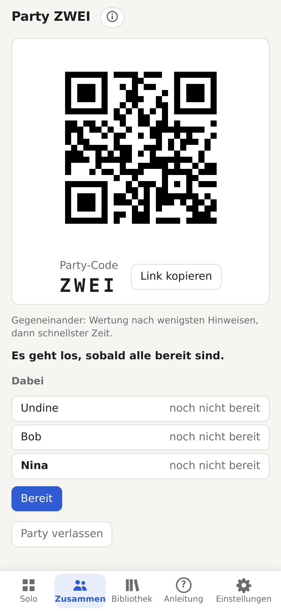

## 2026-11-24 Nachmittag ([`eb1fa5e...773caa5`](https://github.com/Erkenbend/star-battle-solver/compare/eb1fa5e~1...773caa5))

- Lobby zeigt den Party-Link als QR-Code, ohne Abhängigkeit selbst kodiert
- QR-Code klein gehalten: Versionen 1 bis 6, alphanumerisch, Kurzlink `/P/{code}`
- [Umbauvorschläge](architecture/refactorings.md) 11 und 12: `party.go` aufgeteilt, eine Funktion für „Puzzle n mit Seed s“

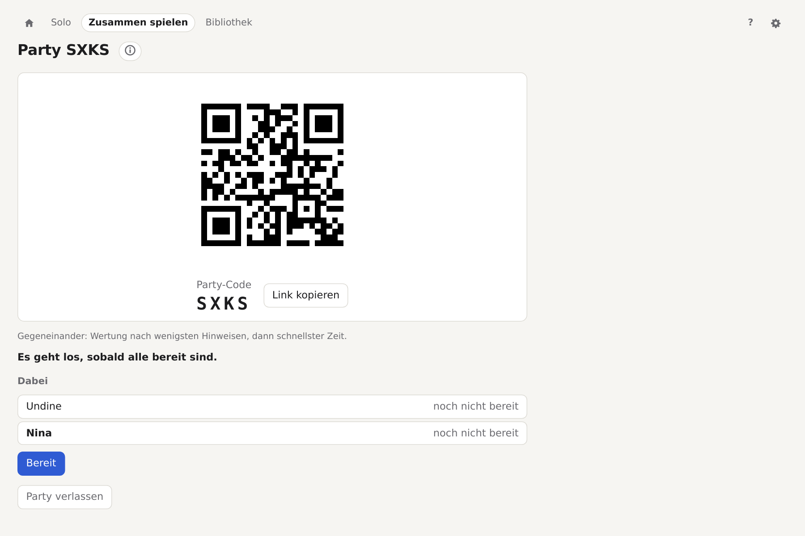

## 2026-11-23 Abend ([`f6f43eb...60e0e1e`](https://github.com/Erkenbend/star-battle-solver/compare/f6f43eb~1...60e0e1e))

- Art der Puzzle-Seite einmal in `Logic.pageKind` bestimmt statt verstreuter Flags
- Gemeinsame Helfer der Seiten in `dom.js`, Speicher und Hilfe als eigene Teile ([Umbauvorschläge](architecture/refactorings.md) 9 und 10)
- Legende einer Miteinander-Runde nennt keine Hinweise mehr

## 2026-11-22 Abend ([`e1bd344...8c2cb9c`](https://github.com/Erkenbend/star-battle-solver/compare/e1bd344~1...8c2cb9c))

- `serve` mit Lösebudget, freiem Platz für wartende Seiten und Cache der letzten 64 Seiten ([Entscheidung 33](architecture/decisions/33-solve-budget.md))
- Verlassene Seiten brechen ihre Lösung ab
- gzip für Seiten und JSON ([Entscheidung 34](architecture/decisions/34-gzip.md))
- Lastszenarien mit `starbattle stress`
- Erklärungen mit strukturierten Verweisen, Texte erst beim Lesen gebaut ([Entscheidung 35](architecture/decisions/35-refs-in-the-trace.md))
- Lookahead bricht aussichtslose Versuche ab: etwa ein Drittel schneller ([Entscheidung 36](architecture/decisions/36-lookahead-stops-trials.md))
- `gofmt -s` in CI und Pre-Commit-Hook

## 2026-11-22 Vormittag ([`560b52f...c03652a`](https://github.com/Erkenbend/star-battle-solver/compare/560b52f~1...c03652a))

- Brett-Geometrie einmal pro Puzzle berechnet, von Kopien geteilt ([Entscheidung 32](architecture/decisions/32-board-geometry.md))
- Golden Files für die Lösungswege der Stichprobe (`TestTraceGolden`)

## 2026-11-21 Vormittag ([`de1225a...52d15bb`](https://github.com/Erkenbend/star-battle-solver/compare/de1225a~1...52d15bb))

- Farbleiste über dem Brett: ein Punkt je Farbe mit Stern
- Seitenwechsel nur über die Tab-Leiste, nach dem Lösen weiter zum nächsten Puzzle ([Entscheidung 30](architecture/decisions/30-ways-between-pages.md))
- `/party` führt zurück zur eigenen Party ([Entscheidung 31](architecture/decisions/31-party-resumes.md))
- Designer: Regionen eines Vorschlags umfärben
- Einstellungen zeigen GitHub-Link, Commit und Bauzeit
- UI-Prüfung in Gruppen nach Seiten, neue Gruppe für den Designer
- Zweite Architektur-Review: [Umbauvorschläge](architecture/refactorings.md) 5 bis 14

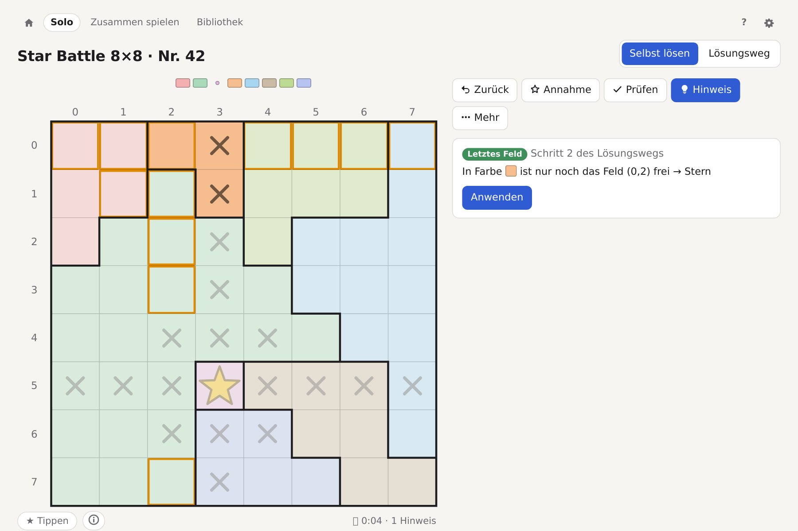

## 2026-11-20 Abend ([`898bdde...c023518`](https://github.com/Erkenbend/star-battle-solver/compare/898bdde~1...c023518))

- Handy-Layout Variante B auf main ([Entscheidung 25](architecture/decisions/25-mobile-first-page.md))
- Installierbar als Web-App ([Entscheidung 26](architecture/decisions/26-installable-web-app.md))
- „/“ führt zurück zum ungelösten Solo-Puzzle ([Entscheidung 27](architecture/decisions/27-solo-resumes.md))
- Banner und Anleitungskarte unter dem Brett ([Entscheidung 28](architecture/decisions/28-news-below-the-board.md))
- Tab „Schwer“ der Bibliothek öffnet fast sofort statt nach fast einer Sekunde
- Designer sucht weiter, bis genug verschiedene Puzzles da sind ([Entscheidung 29](architecture/decisions/29-designer-searches-longer.md))

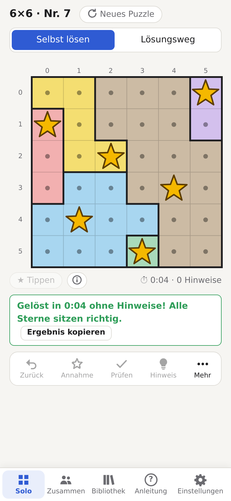

## 2026-11-20 Vormittag und Mittag ([`565b5f1...3e22ce1`](https://github.com/Erkenbend/star-battle-solver/compare/565b5f1~1...3e22ce1))

- Puzzle-Seite zuerst fürs Handy: Aktionsleiste, „Mehr“, Stern-Werkzeug, Tab-Leiste
- Bibliothek, Einstellungen und Party im selben Stil
- Party auf langsamen Handys: Brett springt nicht mehr, nächste Runde lädt nur einmal
- UI-Prüfung auf Handygröße, bei langsamer Verbindung und unter Dauerfeuer
- Party: „Aufgeben“ in der Aktionsleiste

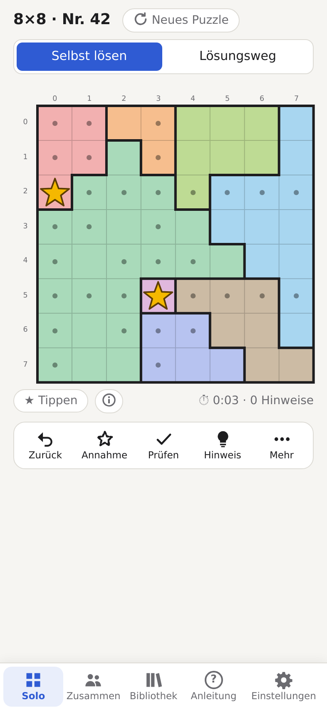

## 2026-11-19 Nachmittag und Abend ([`17f7b0d...6c8b854`](https://github.com/Erkenbend/star-battle-solver/compare/17f7b0d~1...6c8b854))

- Party gegeneinander mit Leben: ein falscher Stern kostet eines
- Lösung nach dem letzten Leben erst auf Wunsch
- Solo: neues Puzzle aus mehreren Größen

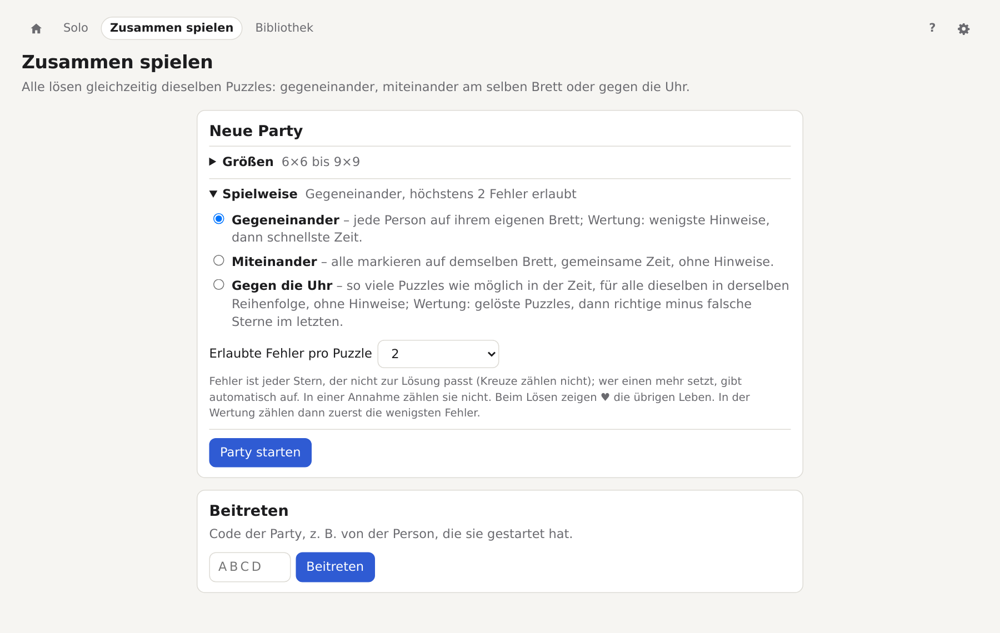

## 2026-11-17 Nachmittag und Abend ([`4b709e6...3287098`](https://github.com/Erkenbend/star-battle-solver/compare/4b709e6~1...3287098))

- Alle zehn nebenläufigen Stellen als Sequenzdiagramm und im Abspieler, gegen den Code geprüft ([Entscheidung 24](architecture/decisions/24-concurrency-animations.md))
- Abspieler auf [GitHub Pages](https://erkenbend.github.io/star-battle-solver/)

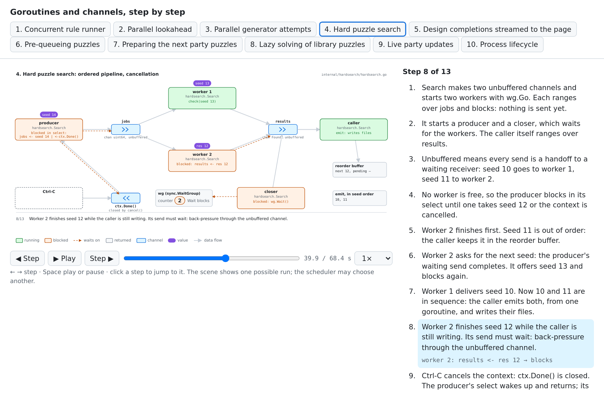

## 2026-11-17 Mittag ([`399d3d5...567616d`](https://github.com/Erkenbend/star-battle-solver/compare/399d3d5~1...567616d))

- Größe 15 im Browser, Bibliothek mit 193 Puzzles ([Entscheidung 23](architecture/decisions/23-size-15.md))
- [concurrency.md](architecture/concurrency.md): jede Goroutine und jeder Channel beschrieben

## 2026-11-16 Abend ([`95af3be...0084b8b`](https://github.com/Erkenbend/star-battle-solver/compare/95af3be~1...0084b8b))

- Option: Zeilen, Spalten und Farben mit Stern blassen aus
- CI mit Stichprobe von 27 schweren Puzzles, 4 statt 36 Minuten ([Entscheidung 22](architecture/decisions/22-ci-sample-only.md))

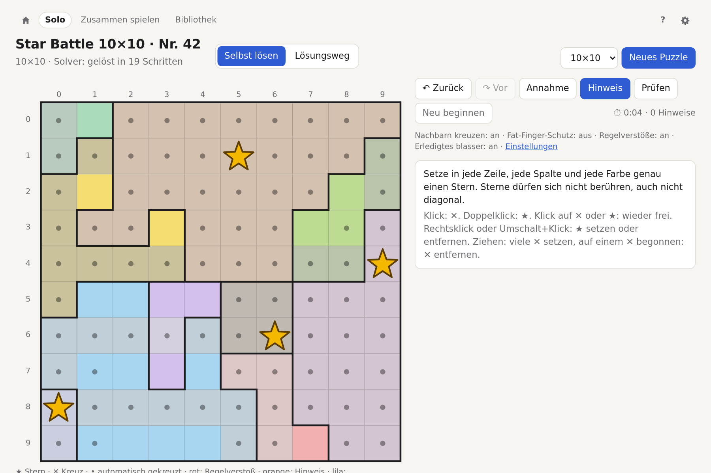

## 2026-11-16 Vormittag ([`caf885d...91355ac`](https://github.com/Erkenbend/star-battle-solver/compare/caf885d~1...91355ac))

- Bibliothek mit 175 schweren Puzzles ([Entscheidung 21](architecture/decisions/21-library-175.md))
- Brute Force mit Bitmasken: 16×16 in 0,18 s statt 1119 s

## 2026-11-15 Nachmittag und Abend ([`ba467f8...ffc2880`](https://github.com/Erkenbend/star-battle-solver/compare/ba467f8~1...ffc2880))

- Klick setzt Kreuz, Doppelklick Stern, Klick auf ein Symbol macht frei

## 2026-11-14 Abend ([`aa9824b...19f133c`](https://github.com/Erkenbend/star-battle-solver/compare/aa9824b~1...19f133c))

- Architektur dokumentiert und umgebaut: eigene Pakete für Sammlungen, Party und Designer, Puzzle-Seite in Teile zerlegt
- UI-Prüfung spielt alle Modi in Chromium durch, auch in der CI
- Sprite-Bilder in Go, kein Python mehr
- Entscheidungen in je einer Datei unter [architecture/decisions](architecture/decisions/README.md)

## 2026-11-14 Vormittag und Mittag ([`7423374...eaf3369`](https://github.com/Erkenbend/star-battle-solver/compare/7423374~1...eaf3369))

- Bibliothek mit Motiven neben den schweren Puzzles, Schwierigkeit in Sternen ([Entscheidung 20](architecture/decisions/20-difficulty-rating.md))
- Party-Modus „Gegen die Uhr“
- Annahme-Modus: Stern probehalber setzen
- Anleitung mit kleinem Übungspuzzle und Rundgang
- Badges, Coverage 84 auf 96 % ([Entscheidung 19](architecture/decisions/19-badges-and-coverage.md))

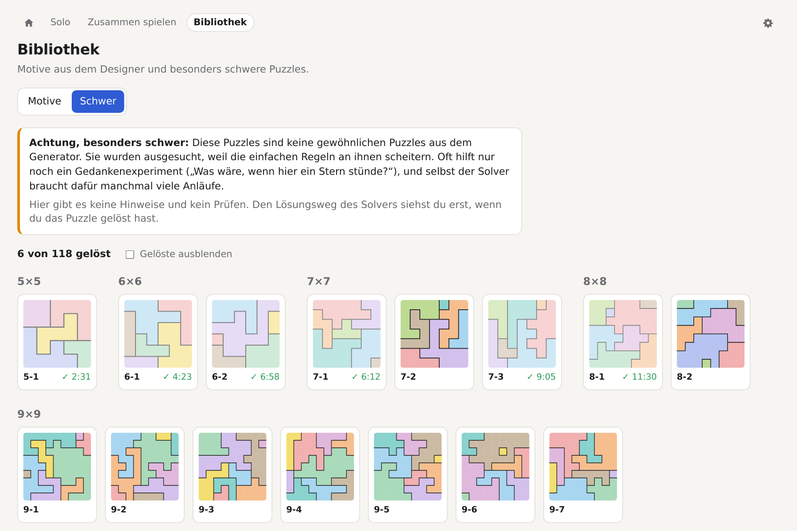

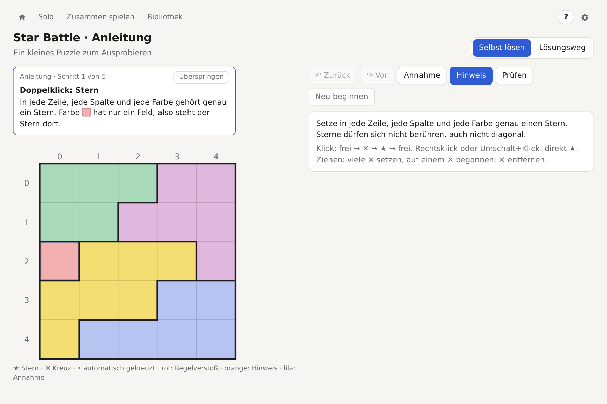

## 2026-11-12 Nachmittag und Abend ([`e76b5ce...5ee671b`](https://github.com/Erkenbend/star-battle-solver/compare/e76b5ce~1...5ee671b))

- Bibliothek wächst auf 118 schwere Puzzles ([Entscheidung 17](architecture/decisions/17-library-over-100-sample-tests.md))
- Befehl `hard` sucht schwere Puzzles ([Entscheidung 18](architecture/decisions/18-hard-command.md))
- Neue Stern-Symbole, animierte mit mehreren Animationen, dazu „Zufällig“

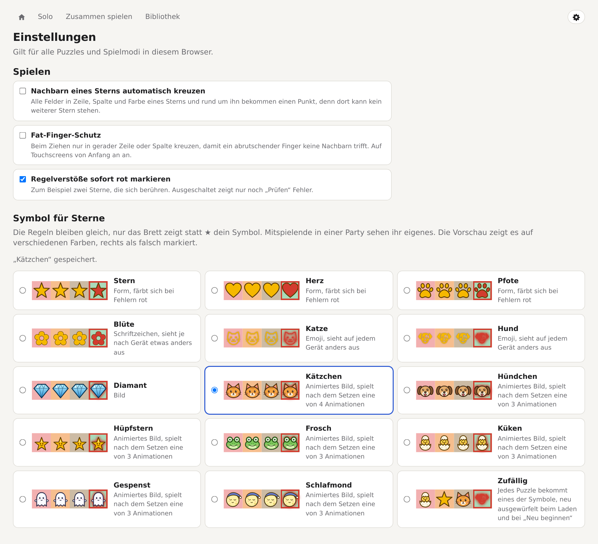

## 2026-11-11 Abend ([`3e8d902...08b161c`](https://github.com/Erkenbend/star-battle-solver/compare/3e8d902~1...08b161c))

- Designer: Muster zeichnen, Rest berechnen lassen, strenger Modus
- Seite „Einstellungen“ mit Symbol für Sterne und allen Spieloptionen

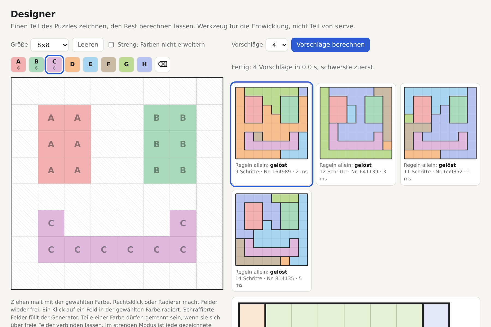

## 2026-11-10 Abend ([`291669c...6c8d72b`](https://github.com/Erkenbend/star-battle-solver/compare/291669c~1...6c8d72b))

- Fehlerseiten mit Navigation, Weg zurück aus verschwundenen Partys
- Skript für die Screenshots

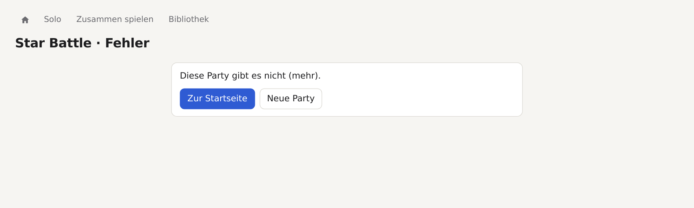

## 2026-11-08 Abend ([`914ce5c...30b5b7d`](https://github.com/Erkenbend/star-battle-solver/compare/914ce5c~1...30b5b7d))

- Party „Miteinander“ auf einem gemeinsamen Brett
- Bibliothek: schwere Puzzles ohne Hilfe lösen
- Veröffentlicht auf GitHub: README, CI mit Builds für fünf Plattformen, MIT-Lizenz

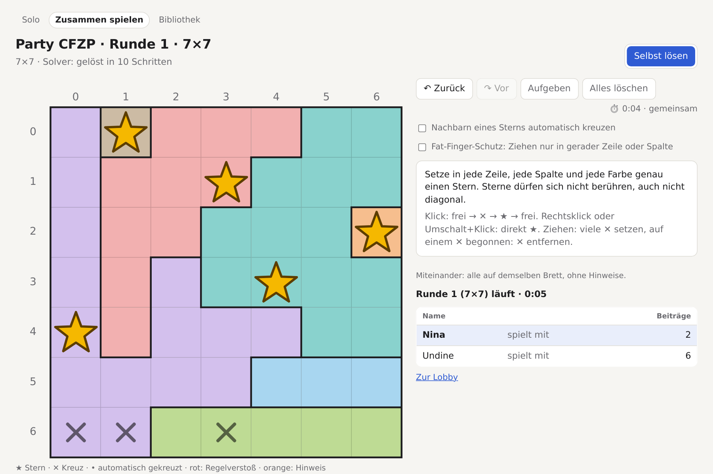

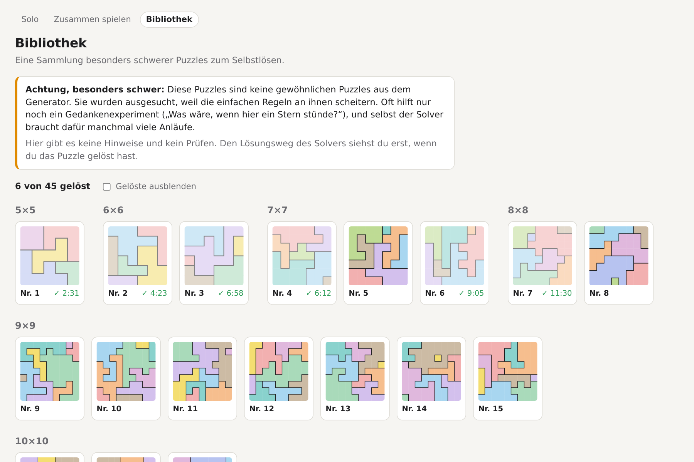

## 2026-11-07 Mittag und Nachmittag ([`2027c59...74a6c72`](https://github.com/Erkenbend/star-battle-solver/compare/2027c59~1...74a6c72))

- Party-Modus gegeneinander mit Rangliste ([Entscheidung 14](architecture/decisions/14-party-mode.md))
- Spielseite: Fat-Finger-Schutz, Prüfen, Brett als SVG, goldene Sterne
- Zehn neue schwere Testpuzzles ([Entscheidung 15](architecture/decisions/15-hard-testdata-for-all-rules.md))

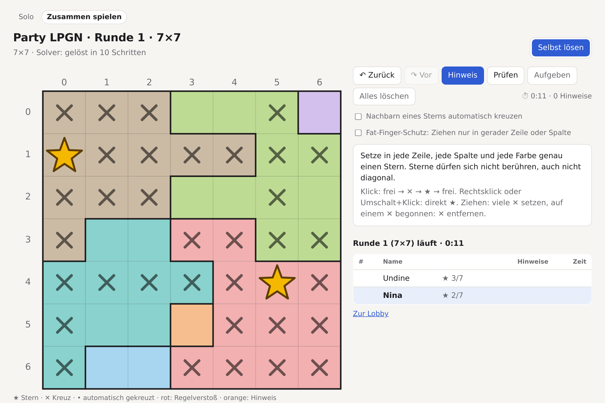

## 2026-11-06 Abend ([`48ea102...ef86ba3`](https://github.com/Erkenbend/star-battle-solver/compare/48ea102~1...ef86ba3))

- Generator: Regionen ab 10×10 mindestens zwei Felder groß ([Entscheidung 12](architecture/decisions/12-min-region-size-2.md)), bis zu vier Versuche parallel ([Entscheidung 13](architecture/decisions/13-parallel-generator-attempts.md))
- Raspberry Pi als systemd-Dienst mit Deploy-Skript
- `serve` hält von jeder Größe ein Puzzle bereit
- Spielseite: Uhr, Hinweiszähler, Ergebnis kopieren

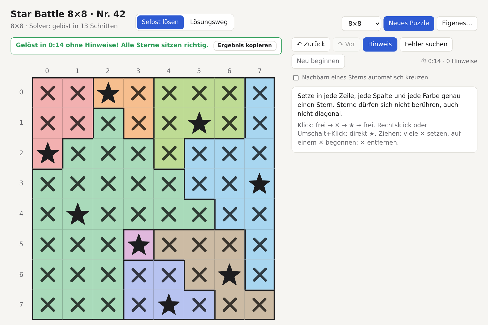

## 2026-11-05 Abend ([`2236d38...5e191f8`](https://github.com/Erkenbend/star-battle-solver/compare/2236d38~1...5e191f8))

- Prioritätsstufen der Regeln ([Entscheidung 6](architecture/decisions/06-priority-levels.md))
- Confinement über benachbarte Zeilen ([Entscheidung 7](architecture/decisions/07-contiguous-confinement.md)), neue Regel Pigeonhole ([Entscheidung 9](architecture/decisions/09-pigeonhole-rule.md))
- Generator repariert durch Verschieben von Regionsteilen: 1,8 s statt 151 s ([Entscheidung 8](architecture/decisions/08-generator-repair-by-pieces.md))
- Interaktive Seite und `serve`: selbst lösen oder Lösungsweg abspielen ([Entscheidung 11](architecture/decisions/11-html-page-and-serve.md))

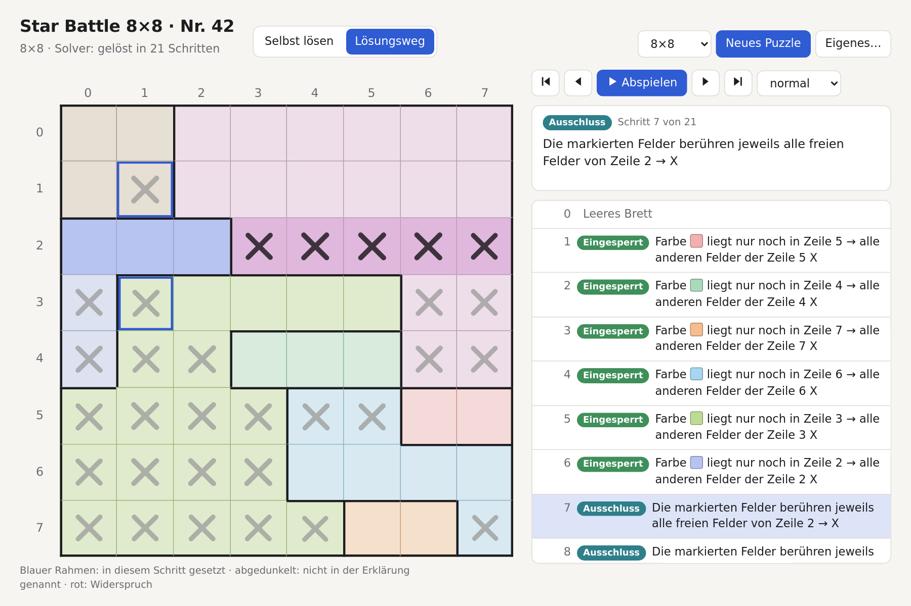

## 2026-11-04 Abend ([`04a6c7a...5e54412`](https://github.com/Erkenbend/star-battle-solver/commits/5e54412))

- Idee in [grober_plan.md](grober_plan.md), daraus PLAN.md
- Puzzle-Modell, Brute-Force-Solver, Generator, Ausgabe im Terminal
- Regeln als Observer, synchron oder mit einer Goroutine pro Regel
- Erste Regeln mit Erklärungen auf Deutsch ([Entscheidung 1](architecture/decisions/01-german-explanations.md))
- Lookahead mit kürzester Widerspruchskette, Backtracking als letzter Ausweg

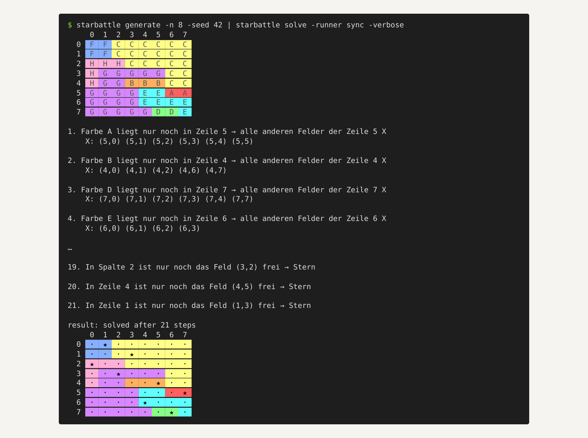
