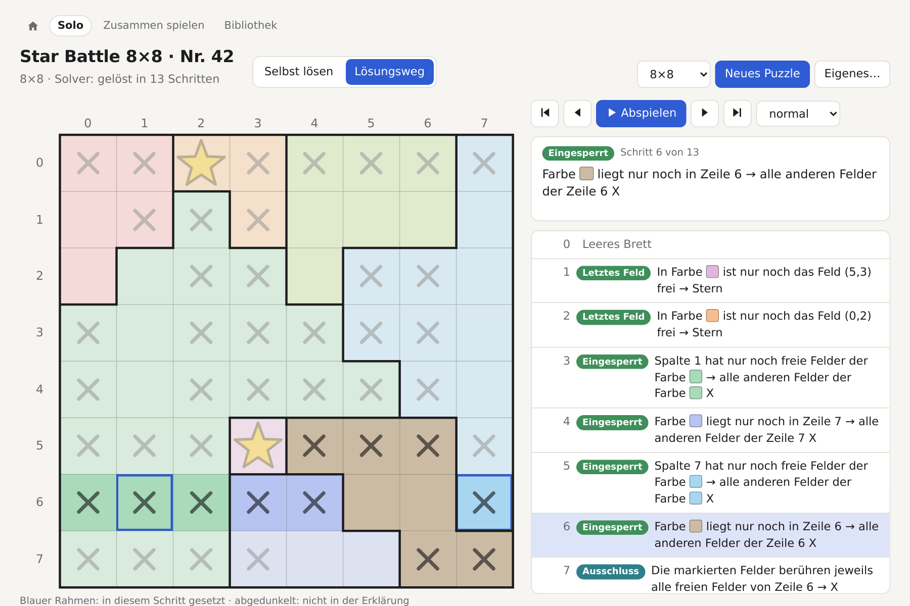
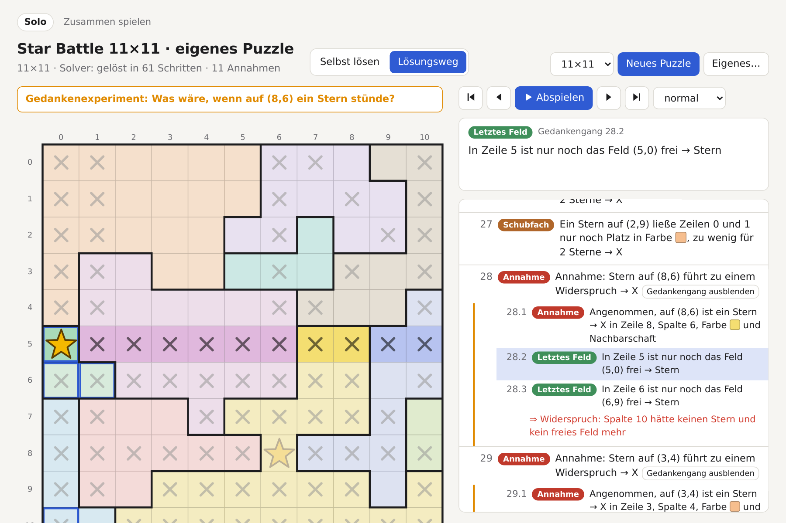
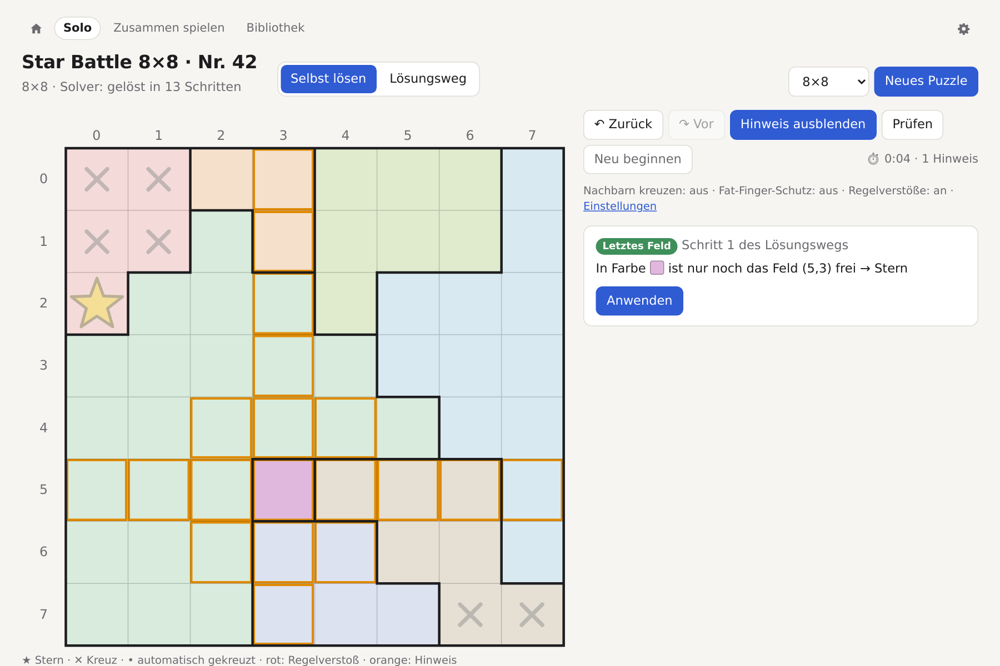
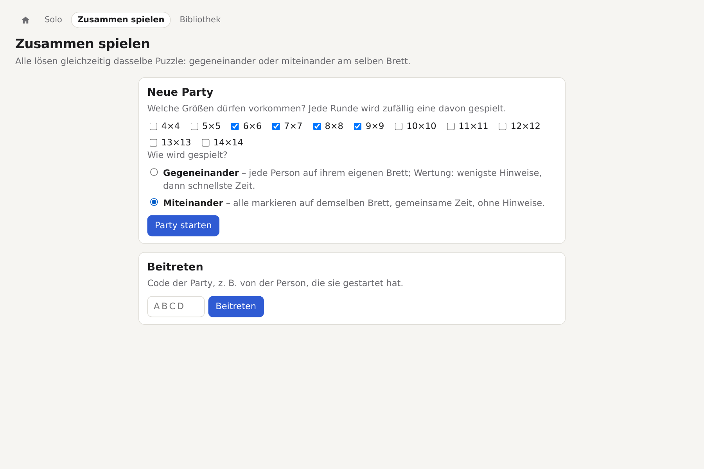
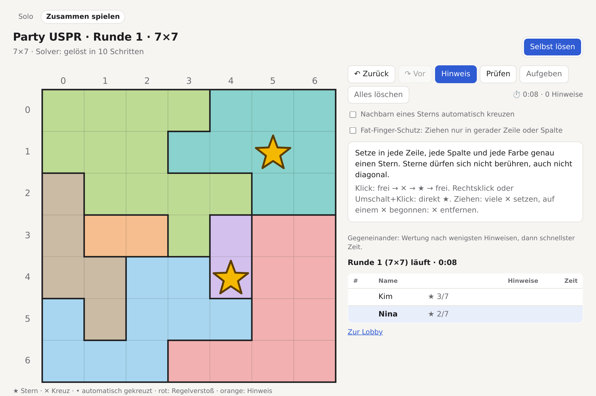
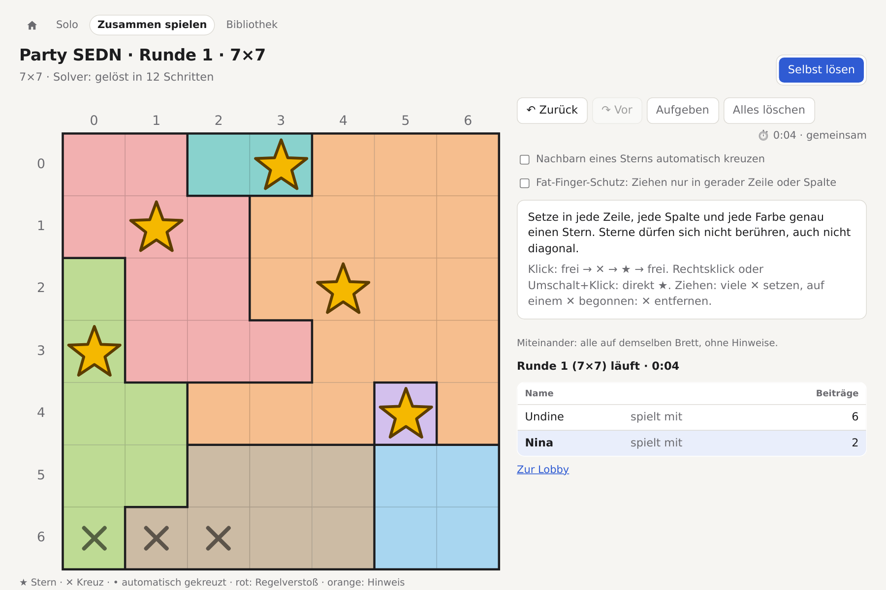
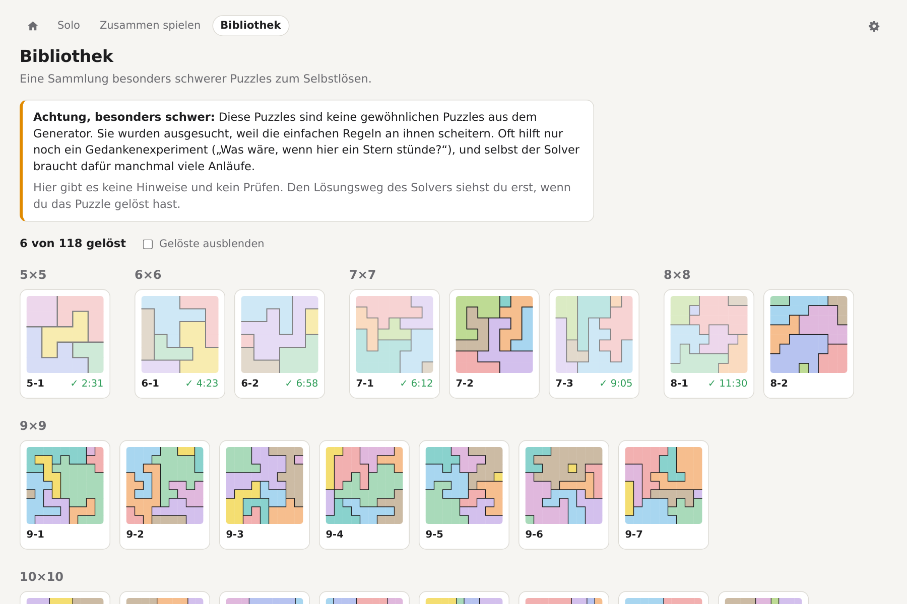
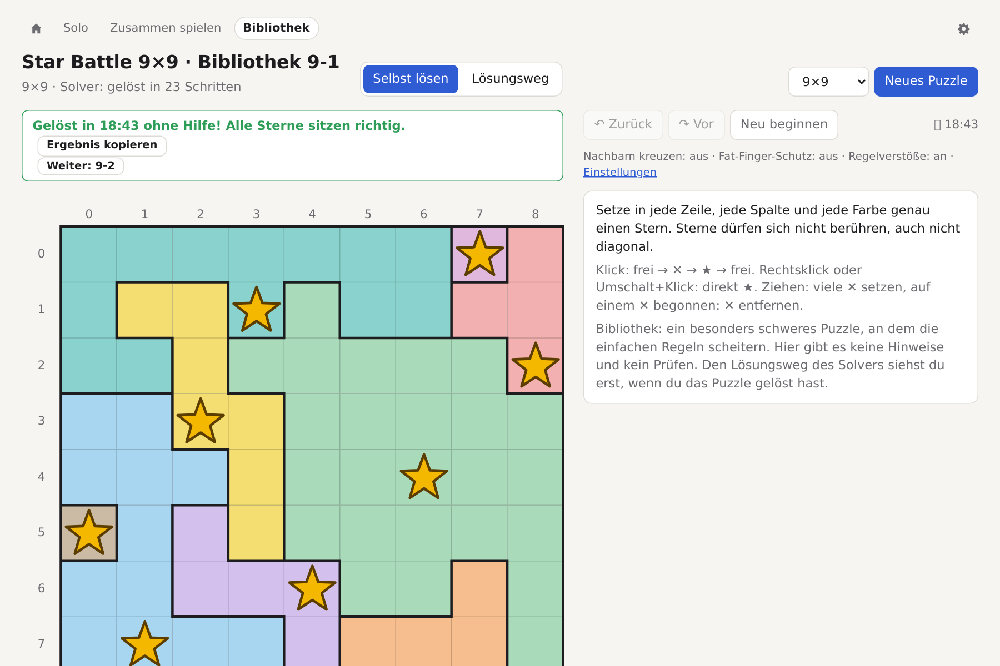

# Star Battle Solver

Erzeugt und löst Star-Battle-Puzzles (auch „Meowdoku“ oder „Queens“) und erklärt jeden Lösungsschritt auf Deutsch.

> **Hinweis:** Die gesamte Implementierung wurde von Claude Opus 5.5 geschrieben, das Projekt ist also auch ein **Vibe-Coding-Experiment**. Von Menschenhand stammt nur [grober_plan.md](grober_plan.md), die Idee ganz am Anfang. Alles andere, Code, Tests, Dokumentation und auch diese README, ist nach und nach in Chats mit Claude entstanden.

**Regeln des Puzzles:** NxN-Brett mit N Farben. In jeder Zeile, jeder Spalte und jeder Farbe steht genau **ein Stern**. Sterne berühren sich nicht, auch nicht diagonal.

## Worum es geht

Ein Star Battle per Brute Force zu lösen ist einfach: Backtracking über die Zeilen, fertig in Millisekunden. Das ist aber weder spannend noch hilfreich, wenn man selbst vor einem Puzzle sitzt und nicht weiterkommt.

Dieses Repo ist ein **Experiment**: Lässt sich ein Star Battle so lösen, **wie ein Mensch es tun würde**? Also Schritt für Schritt mit Regeln, die man nachvollziehen kann („Farbe H liegt nur noch in Zeile 7 → alle anderen Felder der Zeile 7 X“), und mit einer Begründung für jedes einzelne Kreuz und jeden Stern?

- **Logische Regeln statt Suche.** Jede Regel ist ein Muster, das man auch auf Papier erkennt: letztes freies Feld, eingesperrte Farben, Felder, die eine ganze Zeile blockieren, Schubfachprinzip … Einfache Regeln haben Vorrang, so wie man selbst auch zuerst nach dem Offensichtlichen sucht.
- **Gedankenexperiment statt Raten.** Kommen die Regeln nicht weiter, probiert der Solver „Was wäre, wenn hier ein Stern stünde?“ und übernimmt den Widerspruch mit der kürzesten Kette, also den, den ein Mensch am ehesten findet. Echtes Raten mit Backtracking gibt es nur als allerletzten Ausweg.
- **Erklärungen auf Deutsch.** Jeder Schritt wird in Worten erklärt, im Terminal und auf einer interaktiven Seite, wo man den Lösungsweg abspielen oder sich beim eigenen Lösen einen Hinweis holen kann.
- **Eine Bibliothek der härtesten Fälle.** Die Puzzles, an denen die einfachen Regeln scheitern, lassen sich im Browser ohne jede Hilfe lösen. Den Lösungsweg des Solvers gibt es zum Vergleich erst danach.
- **Brute Force nur als Schiedsrichter.** Der Referenz-Solver in `internal/bruteforce` prüft im Generator, dass jedes Puzzle genau eine Lösung hat, und in den Tests, dass die Regeln nichts Falsches folgern.

Nebenbei ist es ein Go-Experiment: Die Regeln laufen als nebenläufige Observer (eine Goroutine pro Regel), die ihre Folgerungen über Channels austauschen. Die ursprüngliche Idee steht in [grober_plan.md](grober_plan.md), Regeln, Messungen und Entscheidungen in [PLAN.md](PLAN.md). Schon die drei Basisregeln lösen etwa 96,5 % der erzeugten Puzzles ohne Gedankenexperiment; die hartnäckigen Fälle liegen in `testdata/hard`.

## Screenshots

| | |
|---|---|
|  |  |
| **Lösungsweg:** jeder Schritt mit Regel und Begründung, die betroffenen Felder sind hervorgehoben. | **Gedankenexperiment:** Bei schweren Puzzles zeigt der Solver die ganze Kette bis zum Widerspruch. |
|  |  |
| **Selbst lösen:** mit Rückgängig, Prüfen und Hinweisen, die den nächsten logischen Schritt zeigen. | **Zusammen spielen:** Party anlegen, Größen und Spielweise wählen, Code oder Link weitergeben. |
|  |  |
| **Gegeneinander:** alle lösen dasselbe Puzzle auf dem eigenen Brett und sehen den Fortschritt der anderen live. | **Miteinander:** alle markieren gemeinsam auf demselben Brett, mit gemeinsamer Zeit. |
|  |  |
| **Bibliothek:** besonders schwere Puzzles zum Stöbern, an denen die einfachen Regeln scheitern. Der Browser merkt sich, welche gelöst sind und in welcher Zeit. | **Ohne Hilfe lösen:** keine Hinweise, kein Prüfen. Danach gibt es den Lösungsweg des Solvers, einen Link zum Teilen und das nächste ungelöste Puzzle. |

Im Terminal sieht derselbe Lösungsweg so aus:

```
$ starbattle generate -n 8 -seed 42 | starbattle solve -runner sync -verbose
1. In Farbe C ist nur noch das Feld (5,3) frei → Stern
2. In Farbe D ist nur noch das Feld (0,2) frei → Stern
3. Spalte 1 hat nur noch freie Felder der Farbe B → alle anderen Felder der Farbe B X
    X: (3,0) (3,4) (4,0) (4,5) (6,0) (7,0)
4. Farbe H liegt nur noch in Zeile 7 → alle anderen Felder der Zeile 7 X
    X: (7,1) (7,6) (7,7)
…
7. Die markierten Felder berühren jeweils alle freien Felder von Zeile 6 → X
    X: (7,5)
8. In Zeile 7 ist nur noch das Feld (7,4) frei → Stern
…
```

## Online spielen

Eine Instanz läuft unter **[meow.ninasworkshop.de](https://meow.ninasworkshop.de)**, und zwar auf meinem Raspberry Pi 3B zu Hause. Weil der hinter NAT steht, ist sie **nur über IPv6** erreichbar; ohne IPv6-Anschluss lädt die Seite nicht. Außerdem ist sie mit Basic Auth geschützt: Wer mich kennt, kann gerne nach einem Zugang fragen. Wer mich nicht kennt, kann das Ganze ebenso gerne selbst hosten; es ist nur eine einzelne Datei ohne Abhängigkeiten (siehe [Herunterladen](#herunterladen) und [deploy/README.md](deploy/README.md)).

Unter „Bibliothek“ liegen die besonders schweren Puzzles aus `testdata/hard` zum Stöbern und Lösen, **ohne Hinweise und ohne Prüfen**. Der Browser merkt sich, welche gelöst sind.

Unter „Zusammen spielen“ lassen sich Partys mit mehreren Leuten spielen, wahlweise **gegeneinander** (jede Person auf ihrem eigenen Brett, Wertung nach Hinweisen und Zeit) oder **miteinander** (alle auf demselben Brett, ohne Hinweise).

## Herunterladen

Bei jedem Push laufen auf GitHub Actions ([`.github/workflows/ci.yml`](.github/workflows/ci.yml)) alle Tests, danach werden die Programme gebaut. Sie hängen als Artefakte am jeweiligen Lauf: unter [Actions](../../actions/workflows/ci.yml?query=branch%3Amain+is%3Asuccess) den letzten erfolgreichen Lauf auf `main` öffnen und unten bei „Artifacts“ die passende Datei herunterladen. Das geht nur mit GitHub-Konto, und GitHub löscht Artefakte nach 90 Tagen.

| Datei | für |
|---|---|
| `starbattle-linux-amd64.tar.gz` | Linux auf PC/Server (x86-64) |
| `starbattle-linux-arm64.tar.gz` | Raspberry Pi 3/4/5 mit 64-Bit-OS (Standard bei aktuellem Raspberry Pi OS) |
| `starbattle-linux-armv7.tar.gz` | Raspberry Pi 2/3/4 mit 32-Bit-OS |
| `starbattle-macos-arm64.tar.gz` | Mac mit Apple-Chip |
| `starbattle-windows-amd64.zip` | Windows |

Für andere Systeme (z. B. Mac mit Intel-Chip) einfach selbst bauen, siehe [Bauen und testen](#bauen-und-testen); Go kann für jede Plattform von jeder Plattform aus bauen, z. B. `GOOS=darwin GOARCH=amd64 go build ./cmd/starbattle`.

Archiv entpacken (`tar xzf …` bzw. unter Windows per Doppelklick), dann `./starbattle serve` starten und `http://localhost:6369/` im Browser öffnen. Auf dem Mac ist das Programm nicht signiert; einmal `xattr -d com.apple.quarantine starbattle` lässt es starten. Für den Raspberry Pi gibt es außerdem [deploy/deploy.sh](deploy/README.md), das passend baut und als Dienst installiert.

## Bauen und testen

Voraussetzung ist Go (Version siehe `go.mod`). Es gibt keine weiteren Abhängigkeiten.

```sh
go build -o starbattle ./cmd/starbattle
go test ./...            # dauert etwa 20 Sekunden
go test -short ./...     # überspringt einige langsame Tests
go test -race ./...
STARBATTLE_ALL_HARD=1 go test ./...   # alle schweren Puzzles statt der Stichprobe
```

Von den schweren Puzzles aus `testdata/hard` prüfen die Tests nur eine Stichprobe (`testdata/hard/sample.idx`), die alle Größen und Regeln abdeckt. Mit `STARBATTLE_ALL_HARD=1` laufen alle Puzzles der Bibliothek durch (dauert etwa sechs Minuten). Die CI auf GitHub Actions prüft immer alle.

Alle Beispiele unten lassen sich statt mit `starbattle` auch mit `go run ./cmd/starbattle` aufrufen.

## Puzzle-Format

Eine Zeile pro Brettzeile, ein Buchstabe pro Feld; gleiche Buchstaben bilden eine Farbe (Region). Leerzeichen werden ignoriert, Zeilen mit `#` sind Kommentare. Möglich sind Bretter bis 52×52 (`A`–`Z`, `a`–`z`).

```
# seed 3
FFFFAA
FFFFFA
CFFAAA
DFFEAA
DFFEBB
DDDEBB
```

Koordinaten in Erklärungen sind (Zeile, Spalte), beginnend bei 0.

## Befehle

Alle Befehle, die ein Puzzle lesen, nehmen eine Datei als Argument oder lesen ohne Datei von der Standardeingabe.

### `generate`: Puzzle erzeugen

```sh
starbattle generate -n 8 -seed 42 > p.txt
```

| Option | Bedeutung |
|---|---|
| `-n N` | Größe (Standard 8) |
| `-seed S` | Zufalls-Seed; gleicher Seed und gleiche Größe ergeben dasselbe Puzzle. 0 (Standard) = nach Uhrzeit |
| `-min-region K` | kleinste erlaubte Region (Standard: 2 ab N = 10, sonst 1) |
| `-show` | Puzzle und Lösung zusätzlich farbig auf stderr ausgeben |
| `-nocolor` | mit `-show`: Buchstaben statt Farben |

Jedes erzeugte Puzzle hat genau eine Lösung. Bis N = 12 geht das in Sekundenbruchteilen, N = 14 dauert einige Sekunden.

### `show`: Puzzle anzeigen

```sh
starbattle show -solution p.txt
```

| Option | Bedeutung |
|---|---|
| `-solution` | zusätzlich die Lösung zeigen (per Brute Force; warnt, wenn sie nicht eindeutig ist) |
| `-nocolor` | Buchstaben statt Farben |

### `solve`: Puzzle lösen und erklären

```sh
starbattle solve -verbose p.txt                  # jeden Schritt in Worten
starbattle solve -step -runner sync p.txt        # Brett nach jedem Schritt
starbattle generate -n 10 | starbattle solve -verbose
```

| Option | Bedeutung |
|---|---|
| `-verbose` | jeden Schritt erklären |
| `-step` | Brett nach jedem Schritt zeigen (neue Felder in `[ ]`) |
| `-nocolor` | Buchstaben statt Farben |

Dazu kommen die **Solver-Optionen**, die auch `html` und `serve` verstehen:

| Option | Bedeutung |
|---|---|
| `-runner concurrent\|sync` | `concurrent`: eine Goroutine pro Observer (Standard bei `solve`); `sync`: alle reihum, mit reproduzierbarer Erklärung (Standard bei `html` und `serve`) |
| `-search full\|lookahead\|none` | was passiert, wenn die Regeln stecken bleiben: Lookahead und Raten (Standard), nur Lookahead, oder aufhören |
| `-partner-depth N` | Regel `ForcedPartner`: Länge der Ketten erzwungener Sterne (Standard 1, 0 = aus) |
| `-dead-max N` | Regel `DeadCells`: höchstens so viele verbleibende Felder einer Einheit (Standard 2, 0 = aus) |
| `-pigeonhole-max N` | Regel `Pigeonhole`: höchstens so viele Einheiten gleichzeitig (Standard 2, 0 = aus) |
| `-non-contiguous` | Regel `Confinement` mit k ≥ 2: beliebige Zeilen/Spalten statt nur benachbarter |

Am Ende steht das Ergebnis (`solved`, `stuck` oder ein Widerspruch) und, falls gesucht wurde, wie viele Lookahead-Schritte und geratene Sterne nötig waren.

### `html`: interaktive Seite als Datei

```sh
starbattle html -o p.html p.txt
```

Eine einzelne HTML-Datei ohne externe Abhängigkeiten: selbst lösen (mit Rückgängig, Prüfen, Hinweisen, Uhr) oder den Lösungsweg Schritt für Schritt abspielen.

| Option | Bedeutung |
|---|---|
| `-o Datei` | Ausgabedatei (Standard: stdout) |
| `-title T` | Seitentitel (Standard: aus dem Dateinamen) |

Dazu die Solver-Optionen wie bei `solve`.

### `serve`: im Browser spielen

```sh
starbattle serve                        # http://localhost:6369/
starbattle serve -addr :6369            # im ganzen Netz erreichbar
```

Dieselbe Seite wie bei `html`, dazu „Neues Puzzle“ (Größe 4 bis 14), eigene Puzzles einfügen und der Party-Modus unter `/party`: mehrere spielen dieselben Runden, wahlweise gegeneinander (jede Person auf ihrem eigenen Brett, Wertung nach Hinweisen und Zeit) oder miteinander (alle markieren auf demselben Brett, gemeinsame Zeit, ohne Hinweise; gleichzeitige Änderungen derselben Zelle entscheidet der Server: wer zuerst ankommt, gewinnt). Jedes Puzzle hat eine feste URL, z. B. `/?n=8&seed=42`, also dasselbe Puzzle wie `generate -n 8 -seed 42`.

Unter `/bibliothek` liegen die Puzzles aus `testdata/hard`, nach Größe sortiert und mit Vorschau. Gelöst wird dort ohne Hilfe: Es gibt keine Hinweise, kein Prüfen und den Lösungsweg erst nach dem Lösen. Welche Puzzles gelöst sind (und die beste Zeit), merkt sich der Browser. Nach dem Lösen geht es mit „Weiter“ zum nächsten ungelösten Puzzle, und „Ergebnis kopieren“ gibt einen Link der Form `/bibliothek?id=14cd642742` mit. Die ID wird aus den Regionen berechnet. Links und gespeicherte Ergebnisse bleiben deshalb gültig, auch wenn sich der Generator ändert (die Seeds in den Dateien erzeugen heute schon andere Puzzles). Die angezeigte Nummer ergibt sich aus der Reihenfolge in `testdata/hard/bibliothek.idx`. Neue Puzzles werden dort nur unten angehängt. Vorgerechnet wird in der Bibliothek nichts: Der Solver startet beim ersten Aufruf eines Puzzles im Hintergrund, und `-no-pregen` betrifft sie nicht.

Unter `/einstellungen` (Zahnrad oben rechts) liegen die Optionen fürs Spielen. Sie gelten in allen Spielmodi und werden im Browser gespeichert, also pro Gerät:

- **Nachbarn eines Sterns automatisch kreuzen:** Felder, auf denen wegen eines Sterns kein weiterer stehen kann, bekommen einen Punkt.
- **Fat-Finger-Schutz:** Beim Ziehen wird nur in gerader Zeile oder Spalte gekreuzt. Auf Touchscreens ist er von Anfang an an.
- **Regelverstöße sofort rot markieren:** Ist das aus, zeigt nur noch „Prüfen“ Fehler.
- **Symbol für Sterne** (siehe unten)

Die Spielseite zeigt unter den Knöpfen, wie die Optionen stehen, mit einem Link dorthin. Eine offene Spielseite übernimmt Änderungen sofort. In einer mit `html` gespeicherten Datei gibt es keine Einstellungsseite, dort stehen die drei Schalter direkt auf der Seite.

Welches Symbol das Brett statt ★ zeigt, wählt man aus Vorschlägen, die in `symbols/symbols.json` stehen und ins Programm eingebaut werden. Es gibt vier Arten:

| Art | Beispiel | Eigenschaften |
|---|---|---|
| `svg` | Stern, Herz, Pfote | Pfad in einem 100×100-Feld. Sieht überall gleich aus, nimmt die Sternfarbe an und wird bei Fehlern rot. |
| `glyph` | ✿ | Schriftzeichen, als Text dargestellt (nie als Emoji). Nimmt die Farben an, sieht aber je nach Schrift des Geräts etwas anders aus. |
| `emoji` | 🐱, 🐶 | Emoji aus der Schrift des Geräts. Behält die eigenen Farben und sieht auf jedem System anders aus; fehlt eine Emoji-Schrift, erscheint ein leeres Kästchen. |
| `sprite` | Diamant, Kätzchen, Hündchen, Hüpfstern, Frosch, Küken, Gespenst, Schlafmond | Bilddatei (`.svg`, `.png`, `.webp`, höchstens 256 KiB) im Verzeichnis `symbols/`. Mit `frames` und `fps` ein animiertes Bild: alle Einzelbilder (je 100×100) nebeneinander. Die Animation spielt nur nach dem Setzen eines Sterns etwa drei Sekunden lang, danach bleibt das erste Bild stehen; wünscht das System reduzierte Bewegung, gar nicht. Mit `clips` hat ein Bild mehrere Animationen (siehe unten). |

Mehrere Animationen: `clips` teilt die Einzelbilder in Abschnitte `{"name": …, "start": …, "frames": …}` (der Name ist nur für Lesende). Beim Setzen eines Sterns spielt einer davon, zufällig gewählt und nach Möglichkeit nicht derselbe wie beim letzten Mal. Danach bleibt Bild 0 stehen, die Ruhepose; sie gehört meist zu keinem Abschnitt. Ohne `clips` sind alle Bilder eine Animation. Die animierten Bilder entstehen mit den Skripten in `symbols/` (`cat.py`, `dog.py`, `hop.py`, `frog.py`, `chick.py`, `ghost.py`, `moon.py`, z. B. `python3 symbols/cat.py > symbols/cat.svg`), die auch die passenden `frames` und `clips` ausgeben.

Was die Farben nicht annimmt, leuchtet bei Fehlern rot. Bilder lädt die Seite vom Server; in einer mit `html` gespeicherten Datei erscheint stattdessen der Stern. GIF und animiertes PNG/WebP sind absichtlich nicht vorgesehen, weil sie sich nicht anhalten lassen.

| Option | Bedeutung |
|---|---|
| `-addr` | Adresse (Standard `localhost:6369`) |
| `-no-pregen` | kein vorbereitetes Puzzle je Größe im Hintergrund bereithalten |

Dazu die Solver-Optionen wie bei `solve`. Für den Betrieb auf einem Raspberry Pi siehe [deploy/README.md](deploy/README.md).

### `design`: Puzzles entwerfen (für Entwickler)

```sh
starbattle design                       # http://localhost:6370/, speichert nach designs/
starbattle design -dir testdata/designs
```

Ein Werkzeug für die Entwicklung, bewusst nicht Teil von `serve`. Auf der Seite zeichnet man einen Teil des Puzzles: Farbe wählen und Felder bemalen, Rechtsklick oder Radierer macht sie wieder frei. Schon beim Zeichnen prüft der Server, ob das Muster in ein gültiges Puzzle passen kann:

- Die Teile jeder Farbe müssen sich über freie Felder verbinden lassen. Getrennt zeichnen ist erlaubt, der Generator verbindet sie.
- Eine ringsum eingeschlossene Farbe braucht mindestens so viele Felder wie jede Region (ab 10×10 zwei).
- Es muss eine Verteilung der Sterne geben, die zum Muster passt, also nicht z. B. eine Farbe, die zwei ganze Zeilen füllt.
- Sind alle Farben gezeichnet, dürfen die Sterne nicht auf mehrere Arten allein auf gezeichneten Feldern Platz finden. Gezeichnete Felder ändert der Generator nie, sonst hätte jedes fertige Puzzle mehrere Lösungen.

Danach berechnet „Vorschläge berechnen“ mehrere Vervollständigungen gleichzeitig, jede in einer eigenen Goroutine mit eigenem Seed (`generator.Complete`). Jeder Vorschlag erscheint, sobald er fertig ist, und lässt sich sofort speichern, während die anderen noch rechnen. Gezeichnete Felder behalten ihre Farbe, und gezeichnete Farben wachsen nur, wo es nötig ist, damit die Form erkennbar bleibt.

Mit „Streng: Farben nicht erweitern“ bleibt jede gezeichnete Farbe genau so, wie sie ist. Dann muss sie zusammenhängend gezeichnet sein, groß genug und mit Platz für ihren Stern, und die freien Felder füllen nur die Farben, die nicht gezeichnet sind: Jede getrennte freie Fläche braucht mindestens eine davon. Bekommt jede freie Fläche genau eine, steht das Puzzle schon fest, und die Seite prüft gleich, ob es eindeutig ist. Sonst lässt der strenge Modus dem Generator weniger Spielraum und scheitert öfter. Zu jedem Vorschlag steht, wie weit die Regeln allein kommen. Den passenden auswählen, optional benennen und speichern: Er landet als `nNN_name.txt` (ohne Namen `nNN_d001.txt` usw.) im Verzeichnis, mit Seed und Muster als Kommentar. Bestehende Dateien werden nie überschrieben. „Ausprobieren“ öffnet den Vorschlag als normale Spielseite.

Bis 12×12 dauert ein Vorschlag meist unter einer Sekunde, 14×14 kann mehrere Minuten brauchen, besonders mit großen rechteckigen Blöcken. Sehr dichte oder verwinkelte Muster schafft der Generator nicht immer; dann hilft es, weniger zu zeichnen.

| Option | Bedeutung |
|---|---|
| `-addr` | Adresse (Standard `localhost:6370`) |
| `-dir` | Verzeichnis für gespeicherte Puzzles (Standard `designs`, wird bei Bedarf angelegt) |

Dazu die Solver-Optionen wie bei `solve`.

### `hard`: schwere Puzzles suchen (für Entwickler)

```sh
go build -o starbattle ./cmd/starbattle    # go build, nicht go run: nur dann steht der Commit im Kopf der Dateien
./starbattle hard -n 13 -from 3001 -count 500 -min-lookahead 4 -o testdata/hard
```

So entsteht Nachschub für `testdata/hard` und damit für die Bibliothek. Der Befehl erzeugt die Puzzles der Seeds `-from` bis `-from + count − 1` genau wie `generate` und prüft jedes: Kommen die Basisregeln weiter? Und wenn nicht, alle Regeln? Wenn auch die nicht weiterkommen, wie viele Lookahead-Schritte (und ob Raten) braucht der Solver? Pro Seed eine Zeile, in Seed-Reihenfolge; Treffer sind mit `HIT` markiert:

```
n=10 seed=450 base=stuck all=solved t=58ms
n=10 seed=451 base=solved t=30ms
n=10 seed=453 base=stuck all=stuck lookahead=4 guesses=0 t=161ms  HIT → n10_s453.txt
```

Mit `-o` landet jeder Treffer als `nNN_sSEED.txt` im Verzeichnis, mit Befehl, Commit und Grund als Kommentar; bestehende Dateien werden nie überschrieben. Am Ende stehen die Zahlen der Suche, der Seed, bei dem die nächste Suche weitermacht (die bisherigen Bereiche stehen in [PLAN.md](PLAN.md)), und die neuen Dateien. In die Bibliothek kommen sie erst, wenn man sie unten an `testdata/hard/bibliothek.idx` anhängt. Ctrl-C bricht nach den laufenden Seeds ab und nennt trotzdem, wo es weitergeht.

Treffer sind selten: Lookahead mit allen Regeln braucht bei 10×10 bis 12×12 etwa jedes 130. Puzzle, bei 13×13 jedes 70., bei 14×14 jedes 50., unter 10×10 praktisch keins. Ein 14×14-Seed dauert bis zu einigen Sekunden.

| Option | Bedeutung |
|---|---|
| `-n` | Größe (Standard 10) |
| `-from` | erster Seed (Standard 1) |
| `-count` | Anzahl Seeds (Standard 100) |
| `-min-lookahead` | Treffer brauchen mit allen Regeln mindestens so viele Lookahead-Schritte (Standard 1); 0: Es reicht, dass die Basisregeln hängen bleiben |
| `-o` | Verzeichnis für Treffer (ohne: nur anzeigen) |
| `-workers` | Seeds gleichzeitig (Standard: Zahl der Kerne) |

## Aufbau

| Verzeichnis | Inhalt |
|---|---|
| `cmd/starbattle` | Kommandozeile |
| `internal/puzzle` | Layout, Textformat, Einheiten (Zeilen, Spalten, Farben) |
| `internal/board` | Zustand des Bretts (frei, Stern, X), Widerspruchserkennung |
| `internal/solver` | Runner (`RunSync`, `RunConcurrent`), Suche mit Lookahead und Raten, Trace |
| `internal/solver/observers` | die logischen Regeln mit Erklärungen |
| `internal/bruteforce` | Referenz-Solver für Generator und Tests |
| `internal/generator` | Puzzles mit eindeutiger Lösung erzeugen, auch um ein gezeichnetes Muster herum |
| `internal/hardsearch` | Suche nach schweren Puzzles für `testdata/hard` (`starbattle hard`) |
| `internal/render` | Ausgabe im Terminal |
| `internal/web` | HTML-Seite, Server, Party-Modus, Bibliothek, Einstellungen, Designer |
| `symbols` | Symbole, die man statt ★ wählen kann (`symbols.json` und Bilder) |
| `deploy` | Installation als systemd-Dienst auf dem Raspberry Pi |
| `designs` | mit `starbattle design` entworfene Puzzles (entsteht beim ersten Speichern) |
| `testdata/hard` | Puzzles, an denen die einfachen Regeln scheitern (Nachschub mit `starbattle hard`); zugleich die Bibliothek im Browser (Reihenfolge in `bibliothek.idx`, Stichprobe für die Tests in `sample.idx`) |
| `docs/screenshots` | Bilder für diese README; `take.sh` nimmt sie neu auf (Go, node ≥ 22, Chromium) |
| `.github/workflows` | Tests und Builds auf GitHub Actions |

## Lizenz

[MIT](LICENSE): Alles ist erlaubt, auch kommerziell und in veränderter Form, solange der Copyright-Hinweis und der Lizenztext erhalten bleiben.
