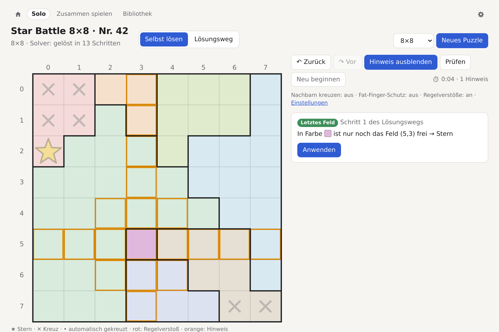
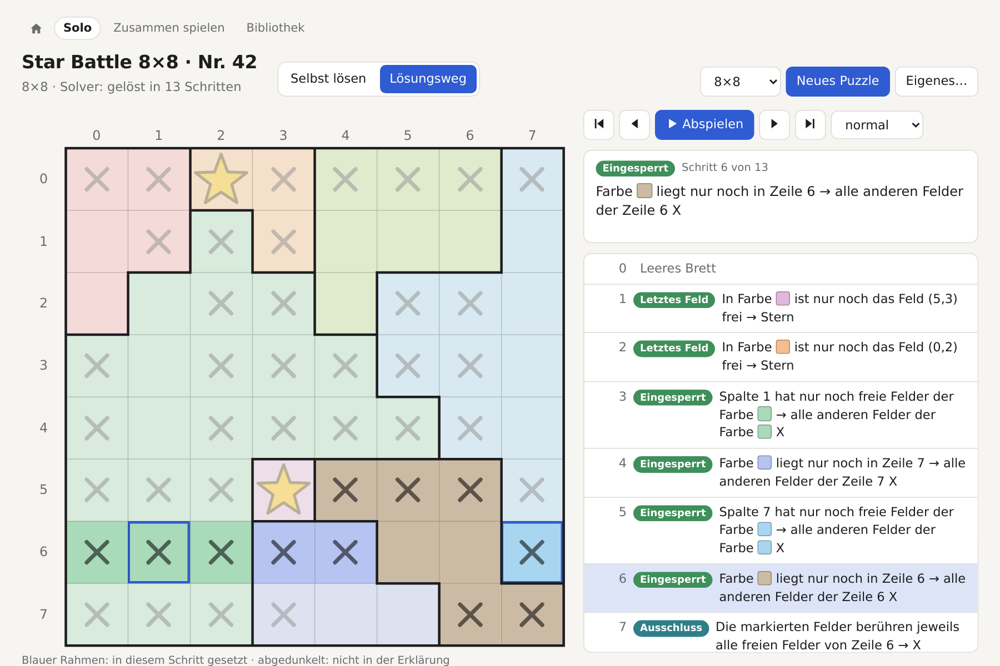
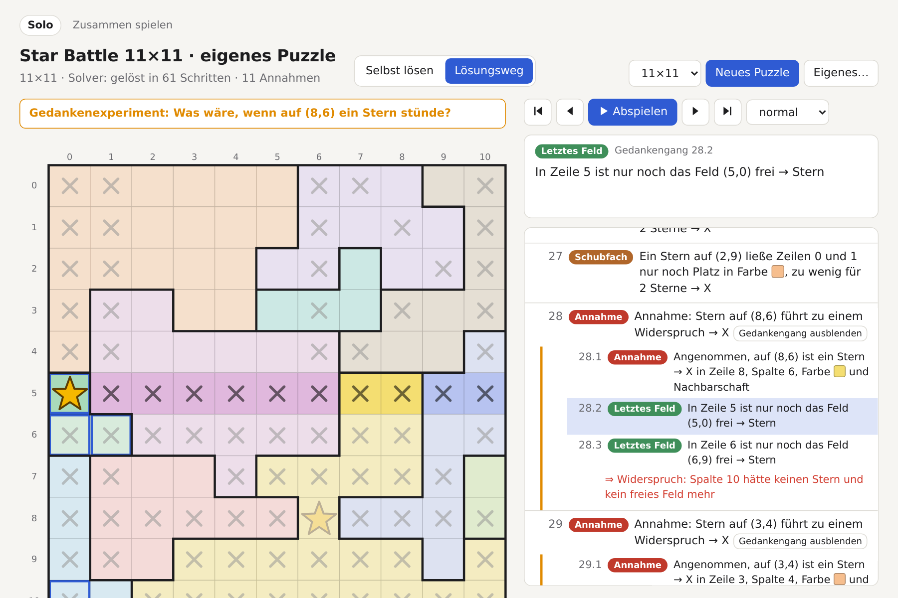
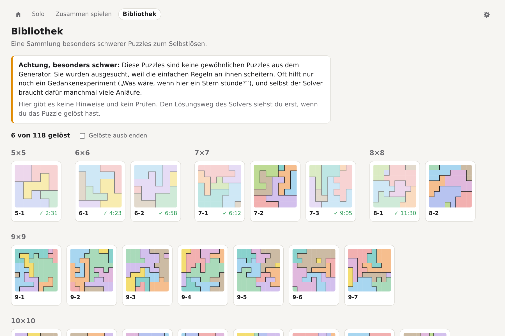
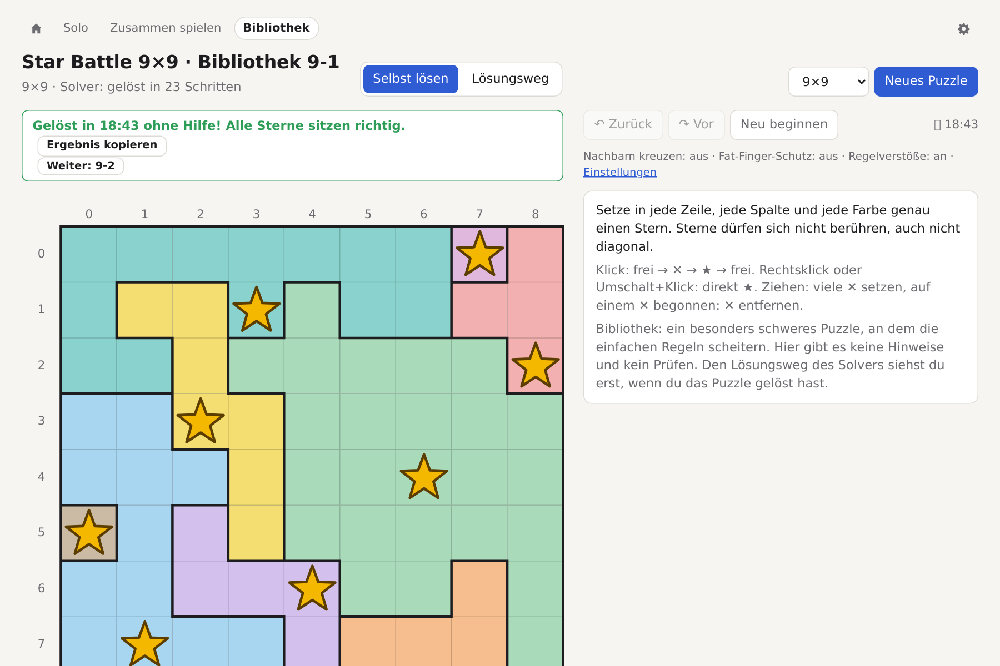
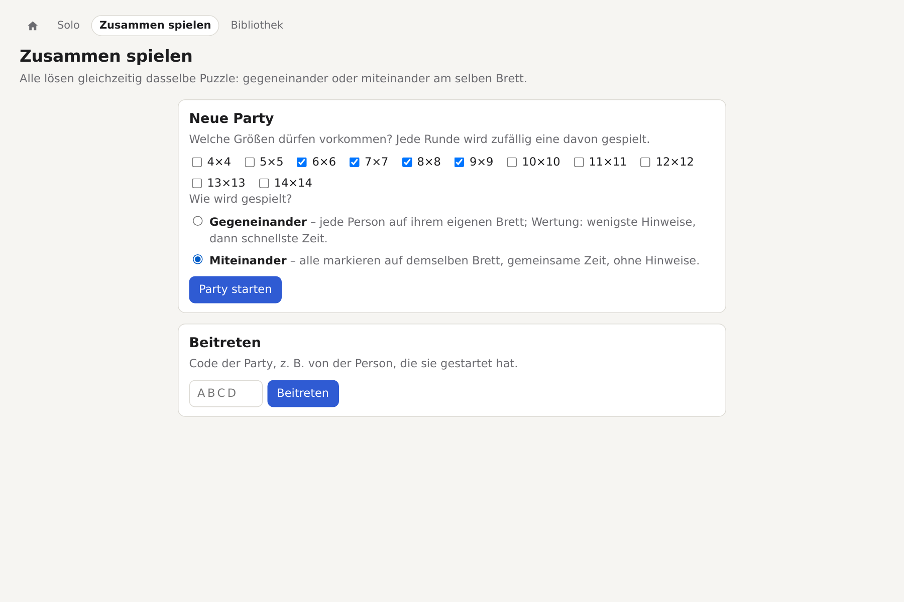
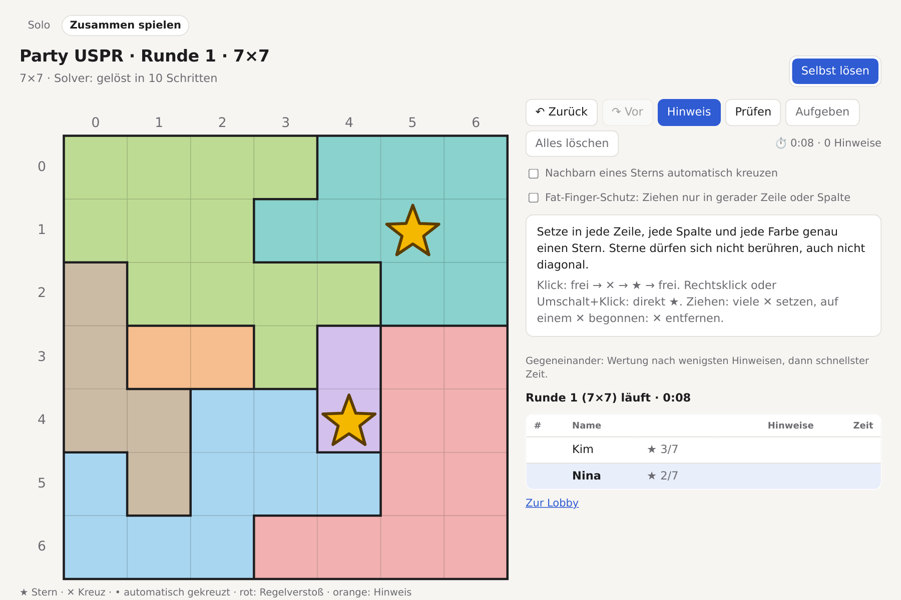
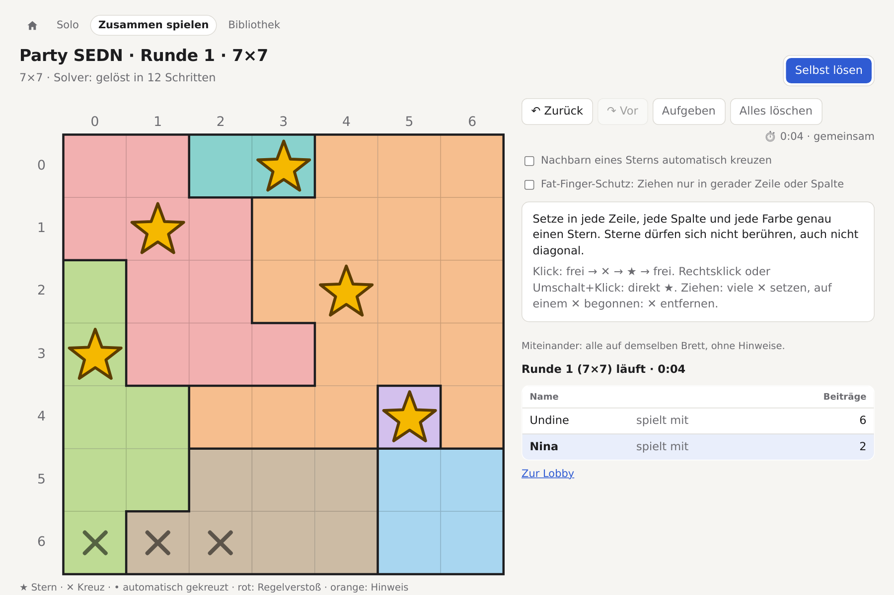

# Spielen im Browser

`starbattle serve` startet die Seite unter `http://localhost:6369/` (Optionen in [commands.md](commands.md#serve-im-browser-spielen)). Dort gibt es vier Bereiche: ein Puzzle selbst lösen oder den Lösungsweg abspielen, die Bibliothek mit Motiven und schweren Puzzles, Partys mit mehreren Leuten und die Einstellungen.

## Selbst lösen und Lösungsweg

| | |
|---|---|
|  |  |
| **Selbst lösen:** mit Rückgängig, Prüfen und Hinweisen, die den nächsten logischen Schritt zeigen. | **Lösungsweg:** jeder Schritt mit Regel und Begründung, die betroffenen Felder sind hervorgehoben. |

„Neues Puzzle“ erzeugt eines der Größe 4 bis 14. Jedes Puzzle hat eine feste URL, z. B. `/?n=8&seed=42`, also dasselbe Puzzle wie `starbattle generate -n 8 -seed 42`. Mit `starbattle html` lässt sich dieselbe Seite auch als einzelne Datei speichern.

Bei schweren Puzzles zeigt der Lösungsweg auch die **Gedankenexperimente**: die ganze Kette von der Annahme „Was wäre, wenn hier ein Stern stünde?“ bis zum Widerspruch.

## Bibliothek

| | |
|---|---|
|  |  |
| **Bibliothek, Teil „Schwer“:** besonders schwere Puzzles zum Stöbern, an denen die einfachen Regeln scheitern. Daneben gibt es Motive aus dem Designer. | **Ohne Hilfe lösen:** keine Hinweise, kein Prüfen. Danach gibt es den Lösungsweg des Solvers, einen Link zum Teilen und das nächste ungelöste Puzzle. |

Die Bibliothek unter `/bibliothek` hat zwei Teile, beide nach Größe sortiert und mit Vorschau. Welcher Teil offen ist, steht im Link (`/bibliothek#motive`, `/bibliothek#schwer`).

- **Motive** sind die Puzzles aus `designs`, im [Designer](development.md#design-puzzles-entwerfen) gezeichnet, sodass die Regionen ein Bild ergeben. Gespielt wird wie beim Solo-Spiel: mit Hinweisen, Prüfen und dem Lösungsweg jederzeit. Jedes Motiv hat einen Namen (Zeile `# name:` in der Datei) statt einer Nummer.
- **Schwer** sind die Puzzles aus `testdata/hard`, an denen die einfachen Regeln scheitern. Gelöst wird dort ohne Hilfe: Es gibt keine Hinweise, kein Prüfen und den Lösungsweg erst nach dem Lösen. Sie heißen nach Größe und Nummer, etwa `10-3`.

Welche Puzzles gelöst sind, merkt sich der Browser, mit dem besten Ergebnis (bei Motiven zählen erst die Hinweise, dann die Zeit). Nach dem Lösen geht es mit „Weiter“ zum nächsten ungelösten Puzzle desselben Teils, und „Ergebnis kopieren“ gibt einen Link der Form `/bibliothek?id=14cd642742` mit. Der Text dazu nennt das Motiv beim Namen bzw. das schwere Puzzle bei seiner Nummer.

Die ID wird aus den Regionen berechnet. Links und gespeicherte Ergebnisse bleiben deshalb gültig, auch wenn sich der Generator ändert (die Seeds in den Dateien erzeugen heute schon andere Puzzles) oder eine Datei umbenannt wird. Die Reihenfolge innerhalb einer Größe (und damit die Nummer schwerer Puzzles) ergibt sich aus `bibliothek.idx` im jeweiligen Verzeichnis. Neue Puzzles werden dort nur unten angehängt. Vorgerechnet wird in der Bibliothek nichts: Der Solver startet beim ersten Aufruf eines Puzzles. Ein schweres Puzzle erscheint sofort, sein Lösungsweg wird im Hintergrund berechnet; ein Motiv wartet auf den Solver, weil die Hinweise ihn brauchen.

## Zusammen spielen

| | |
|---|---|
|  |  |
| **Party anlegen:** Größen und Spielweise wählen, Code oder Link weitergeben. | **Gegeneinander:** alle lösen dasselbe Puzzle auf dem eigenen Brett und sehen den Fortschritt der anderen live. |

Unter `/party` spielen mehrere Leute dieselben Runden, wahlweise:

- **gegeneinander:** jede Person auf ihrem eigenen Brett, Wertung nach Hinweisen und Zeit;
- **miteinander:** alle markieren auf demselben Brett, mit gemeinsamer Zeit und ohne Hinweise. Gleichzeitige Änderungen derselben Zelle entscheidet der Server: Wer zuerst ankommt, gewinnt.
- **gegen die Uhr:** so viele Puzzles wie möglich in 2, 5 oder 10 Minuten, ohne Hinweise. Alle bekommen dieselben Puzzles in derselben Reihenfolge; wer eins gelöst hat, ist sofort beim nächsten. Wie oft man ein Puzzle überspringen darf, legt die Person fest, die die Party anlegt (nie bis beliebig oft). Gewertet werden die gelösten Puzzles, bei Gleichstand die Sterne im Puzzle, an dem man beim Abpfiff saß: jeder richtige zählt eins, jeder falsche minus eins. Der Server hält ein paar Puzzles im Voraus bereit; wer trotzdem schneller ist als der Generator, wartet kurz aufs nächste. Wer später dazukommt, spielt noch mit, nur mit weniger Zeit.

## Einstellungen

Unter `/einstellungen` (Zahnrad oben rechts) liegen die Optionen fürs Spielen. Sie gelten in allen Spielmodi und werden im Browser gespeichert, also pro Gerät:

- **Nachbarn eines Sterns automatisch kreuzen:** Felder, auf denen wegen eines Sterns kein weiterer stehen kann, bekommen einen Punkt.
- **Fat-Finger-Schutz:** Beim Ziehen wird nur in gerader Zeile oder Spalte gekreuzt. Auf Touchscreens ist er von Anfang an an.
- **Regelverstöße sofort rot markieren:** Ist das aus, zeigt nur noch „Prüfen“ Fehler.
- **Symbol für Sterne:** statt ★ zum Beispiel Herz, Pfote, 🐱 oder ein animiertes Kätzchen. Mit **Zufällig** würfelt die Spielseite beim Laden eines aus und behält es, bis man neu lädt oder „Neu beginnen“ drückt; dann kommt ein anderes. Animierte Symbole bewegen sich nur kurz nach dem Setzen eines Sterns, und gar nicht, wenn das System reduzierte Bewegung wünscht. Wie man neue Symbole hinzufügt, steht in [symbols/README.md](../symbols/README.md).

Die Spielseite zeigt unter den Knöpfen, wie die Optionen stehen, mit einem Link dorthin. Eine offene Spielseite übernimmt Änderungen sofort.

In einer mit `starbattle html` gespeicherten Datei gibt es keine Einstellungsseite, dort stehen die drei Schalter direkt auf der Seite. Symbole mit Bilddatei lädt die Seite vom Server; in der Datei erscheint stattdessen der Stern, und „Zufällig“ wählt nur unter den Symbolen ohne Bilddatei.
