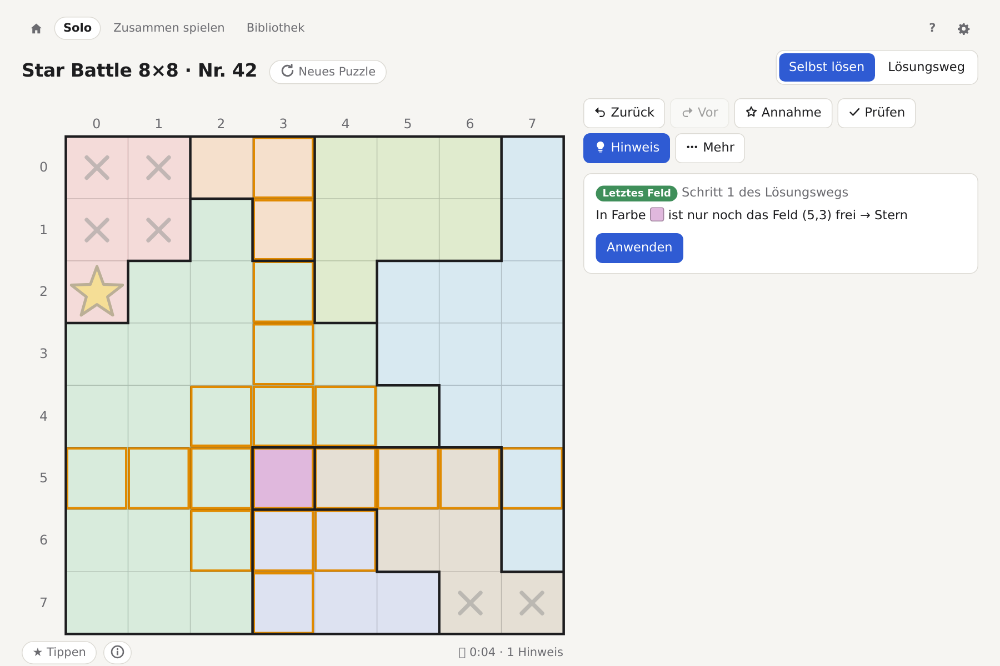
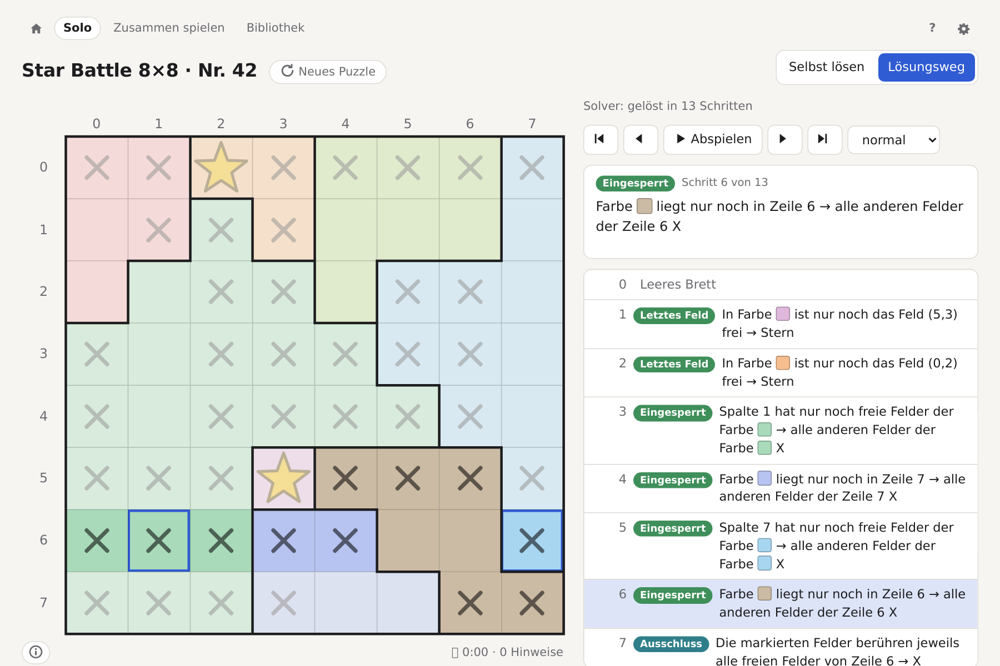
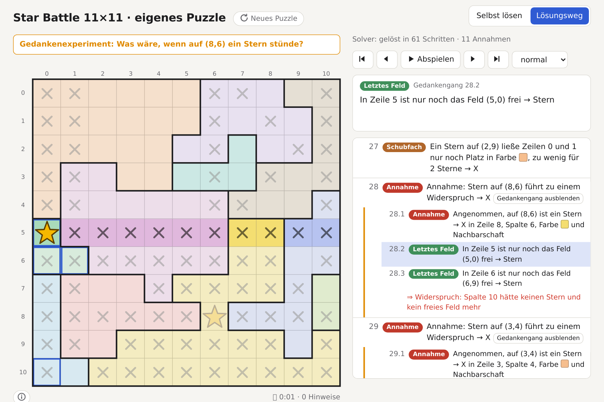
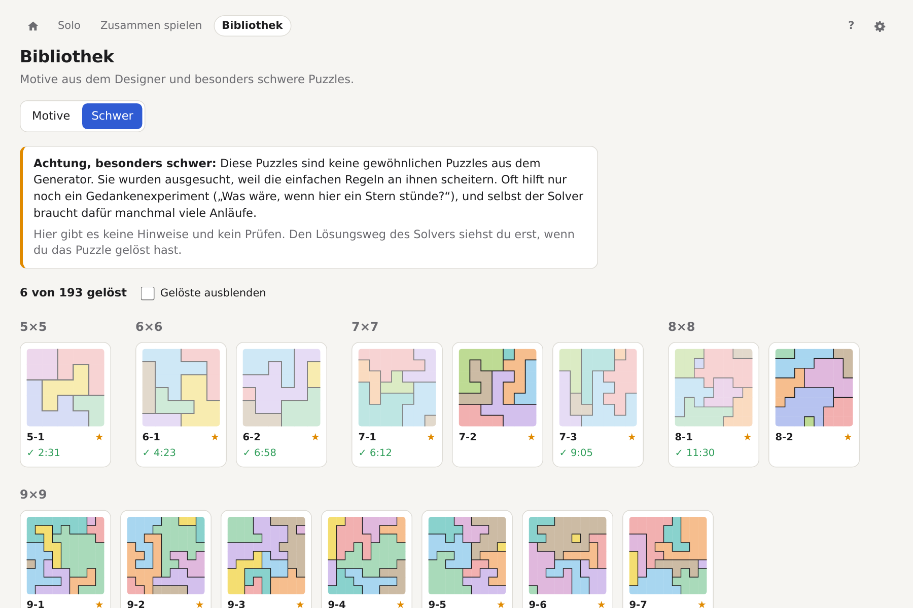
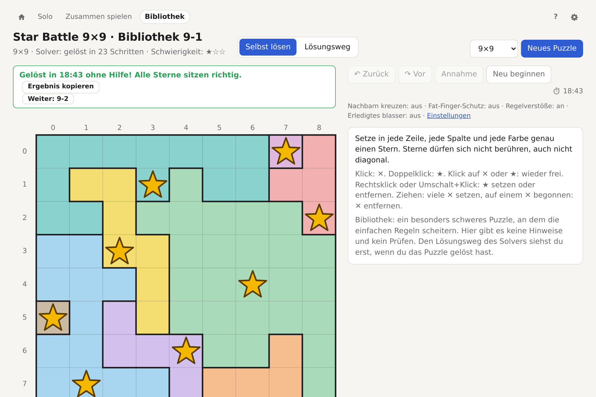
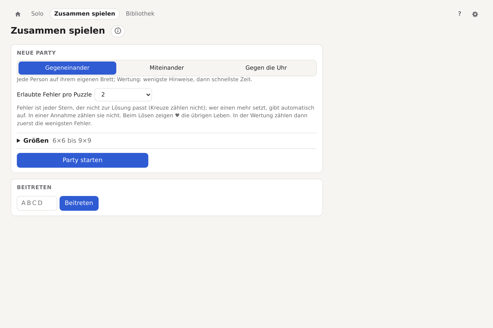
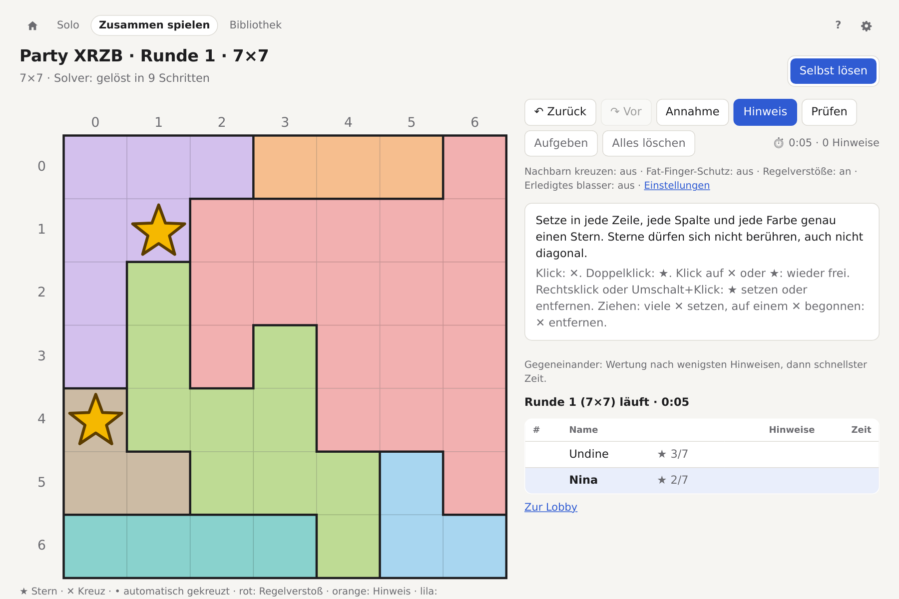
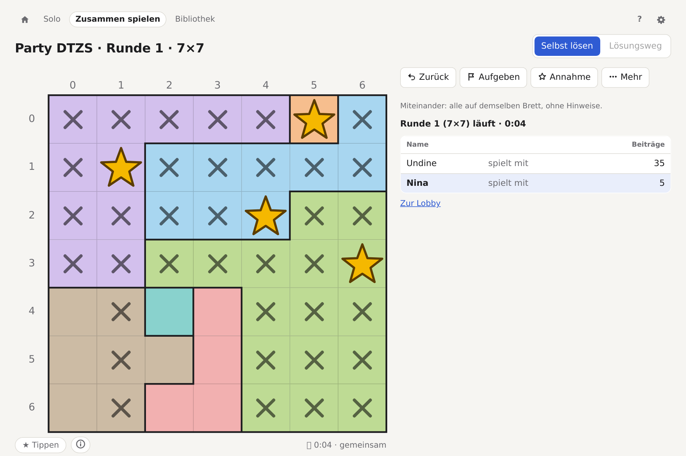

# Spielen im Browser

`starbattle serve` startet die Seite unter `http://localhost:6369/` (Optionen in [commands.md](commands.md#serve-im-browser-spielen)). Dort gibt es vier Bereiche: ein Puzzle selbst lösen oder den Lösungsweg abspielen, die Bibliothek mit Motiven und schweren Puzzles, Partys mit mehreren Leuten und die Einstellungen.

## Anleitung

Unter `/anleitung` (das „?“ oben rechts) löst man ein kleines 5×5-Puzzle Schritt für Schritt: Doppeltippen setzt einen Stern, Ziehen viele Kreuze (Zeile und Spalte des Sterns), Tippen ein Kreuz (die übrigen Nachbarn); die Felder, um die es gerade geht, sind markiert. Den Rest löst man selbst, danach zeigt ein kurzer Rundgang auf „★ Tippen“, Annahme, „Mehr“, ⓘ, Lösungsweg, Zusammen spielen, Bibliothek und Einstellungen. „Überspringen“ beendet die Anleitung jederzeit.

Wer zum ersten Mal ein Solo- oder Bibliotheks-Puzzle öffnet, landet einmal dort und kommt danach zu diesem Puzzle zurück. Ob die Anleitung schon gezeigt wurde, merkt sich der Browser. Wer schon andere Spuren der Seite im Browser hat (Einstellungen, Fortschritt), gilt nicht als neu; eine Party-Runde leitet nie um.

## Selbst lösen und Lösungsweg

| | |
|---|---|
|  |  |
| **Selbst lösen:** mit Rückgängig, Prüfen und Hinweisen, die den nächsten logischen Schritt zeigen. | **Lösungsweg:** jeder Schritt mit Regel und Begründung, die betroffenen Felder sind hervorgehoben. |

Die Seite ist fürs Handy und Tablet gebaut: Neben dem Titel steht „Neues Puzzle“, unter dem Brett „★ Tippen“, ⓘ und die Uhr, darunter eine Leiste mit den Knöpfen zum Spielen: Zurück, Annahme, Prüfen, Hinweis und „Mehr“, in Partys an zweiter Stelle Aufgeben (gegen die Uhr Überspringen, mit der Zahl der übrigen Sprünge am Symbol). Die Reiter „Selbst lösen | Lösungsweg“ erscheinen erst, wenn es einen Lösungsweg zu sehen gibt: in Partys nach der Runde, bei den besonders schweren Puzzles der Bibliothek nach dem Lösen. Kein Knopf ist hervorgehoben; ein Knopf, der gerade an ist (Hinweis gezeigt, Abspielen läuft), ist gefüllt. Auf breiten Bildschirmen steht die Leiste neben dem Brett. Die Bereiche der Seite (Solo, Zusammen, Bibliothek, Anleitung, Einstellungen) liegen auf Handy und Tablet wie in einer App in einer Leiste am unteren Rand, auf breiten Bildschirmen oben.

- **Bedienung:** Tippen setzt ein ✕, Doppeltippen einen ★, Tippen auf ✕ oder ★ macht das Feld wieder frei. Ziehen setzt viele ✕, auf einem ✕ begonnen entfernt es sie. Mit der Maus setzt oder entfernt auch ein Rechtsklick oder Umschalt+Klick einen ★; Strg+Z nimmt zurück, Strg+Y wiederholt (dafür gibt es keinen Knopf).
- **★ Tippen:** Ist der Schalter an, setzt oder entfernt schon ein einfaches Tippen einen Stern; Ziehen kreuzt weiterhin. Er gilt nur, solange die Seite offen ist.
- **ⓘ** klappt unter dem Brett Regeln, Bedienung und die Bedeutung der Farben auf.
- **Mehr** klappt unter der Leiste auf, was man seltener braucht: die Größe neuer Puzzles, Neu beginnen (in Partys Alles löschen) und die Spielhilfen aus den [Einstellungen](#einstellungen) zum direkten Umschalten.
- Was der Solver zum Puzzle sagt (gelöst in wie vielen Schritten, Annahmen), steht im Reiter „Lösungsweg“; dort liegen in der Leiste die Knöpfe zum Abspielen: Anfang, Zurück, Abspielen, Weiter, Ende und das Tempo.

„Neues Puzzle“ neben dem Titel erzeugt mit einem Tipp eines in der Größe, die unter „Mehr“ gewählt ist (4 bis 15, anfangs die des aktuellen Puzzles). Mit „Mehrere Größen“ lassen sich, wie bei einer Party, mehrere Größen ankreuzen; jedes neue Puzzle bekommt dann zufällig eine davon (`/?n=6&n=8&n=10`). Die Auswahl merkt sich der Browser. Jedes Puzzle hat eine feste URL, z. B. `/?n=8&seed=42`, also dasselbe Puzzle wie `starbattle generate -n 8 -seed 42`. Mit `starbattle html` lässt sich dieselbe Seite auch als einzelne Datei speichern.

**Annahme-Modus:** Wer festhängt, drückt „Annahme“ und setzt probehalber einen Stern, dazu Kreuze und weitere Sterne, bis sich ein Widerspruch zeigt. Die Markierungen der Annahme sind lila hinterlegt, ihr erster Stern hat einen Ring. „Widerspruch“ kehrt zum Stand vor der Annahme zurück und kreuzt das Feld dieses Sterns; „Verwerfen“ kehrt nur zurück. Zurück (und Strg+Y) bleibt innerhalb der Annahme, Hinweise und Prüfen gibt es während der Annahme nicht. Wer in der Annahme fertig löst, hat ganz normal gelöst. In Partys bleibt eine Annahme privat: Gegeneinander und gegen die Uhr zählen ihre Sterne nicht für den Stand, miteinander sehen die anderen sie nicht.

Bei schweren Puzzles zeigt der Lösungsweg auch die **Gedankenexperimente**: die ganze Kette von der Annahme „Was wäre, wenn hier ein Stern stünde?“ bis zum Widerspruch.

## Bibliothek

| | |
|---|---|
|  |  |
| **Bibliothek, Teil „Schwer“:** besonders schwere Puzzles zum Stöbern, an denen die einfachen Regeln scheitern. Daneben gibt es Motive aus dem Designer. | **Ohne Hilfe lösen:** keine Hinweise, kein Prüfen. Danach gibt es den Lösungsweg des Solvers, einen Link zum Teilen und das nächste ungelöste Puzzle. |

Die Bibliothek unter `/bibliothek` hat zwei Teile, beide nach Größe sortiert und mit Vorschau, auf dem Handy drei Kacheln je Zeile. Welcher Teil offen ist, steht im Link (`/bibliothek#motive`, `/bibliothek#schwer`). Was die Teile sind, klappt ⓘ neben dem Titel auf; im Teil „Schwer“ steht eine Zeile Warnung über den Kacheln.

- **Motive** sind die Puzzles aus `designs`, im [Designer](development.md#design-puzzles-entwerfen) gezeichnet, sodass die Regionen ein Bild ergeben. Gespielt wird wie beim Solo-Spiel: mit Hinweisen, Prüfen und dem Lösungsweg jederzeit. Jedes Motiv hat einen Namen (Zeile `# name:` in der Datei) statt einer Nummer.
- **Schwer** sind die Puzzles aus `testdata/hard`, an denen die einfachen Regeln scheitern. Gelöst wird dort ohne Hilfe: Es gibt keine Hinweise, kein Prüfen und den Lösungsweg erst nach dem Lösen. Sie heißen nach Größe und Nummer, etwa `10-3`. Jedes hat eine Schwierigkeit von ★☆☆ (die Regeln allein reichen) über ★★☆ (Gedankenexperimente nötig) bis ★★★ (viele oder lange Gedankenexperimente). Sie steht auf der Kachel (nur die vollen Sterne), über dem Brett und im geteilten Ergebnis (wie sie berechnet wird, steht in [development.md](development.md#schwierigkeit)).

Welche Puzzles gelöst sind, merkt sich der Browser, mit dem besten Ergebnis (bei Motiven zählen erst die Hinweise, dann die Zeit). Nach dem Lösen geht es mit „Weiter“ zum nächsten ungelösten Puzzle desselben Teils, und „Ergebnis kopieren“ gibt einen Link der Form `/bibliothek?id=14cd642742` mit. Der Text dazu nennt das Motiv beim Namen bzw. das schwere Puzzle bei seiner Nummer.

Die ID wird aus den Regionen berechnet. Links und gespeicherte Ergebnisse bleiben deshalb gültig, auch wenn sich der Generator ändert (die Seeds in den Dateien erzeugen heute schon andere Puzzles) oder eine Datei umbenannt wird. Die Reihenfolge innerhalb einer Größe (und damit die Nummer schwerer Puzzles) ergibt sich aus `bibliothek.idx` im jeweiligen Verzeichnis. Neue Puzzles werden dort nur unten angehängt. Vorgerechnet wird in der Bibliothek nichts: Der Solver startet beim ersten Aufruf eines Puzzles. Ein schweres Puzzle erscheint sofort, sein Lösungsweg wird im Hintergrund berechnet; ein Motiv wartet auf den Solver, weil die Hinweise ihn brauchen.

## Zusammen spielen

| | |
|---|---|
|  |  |
| **Party anlegen:** Spielweise wählen (darunter steht, wie sie geht), die Größen zum Aufklappen, Code oder Link weitergeben. | **Gegeneinander:** alle lösen dasselbe Puzzle auf dem eigenen Brett und sehen den Fortschritt der anderen live. |

Unter `/party` spielen mehrere Leute dieselben Runden, wahlweise:

- **gegeneinander:** jede Person auf ihrem eigenen Brett, Wertung nach Hinweisen und Zeit. Wer die Party anlegt, kann die erlaubten Fehler pro Puzzle begrenzen (beliebig viele bis keiner); sie funktionieren wie Leben, ein Leben mehr als erlaubte Fehler. Fehler ist jeder Stern, der nicht zur Lösung passt, und kostet ein Leben, sobald er gesetzt ist; Kreuze zählen nicht. Der Stern ist dann rot markiert, solange er steht, und kostet auf demselben Feld nur einmal. Neben der Zeit stehen die übrigen Leben als ♥; wer das letzte verliert, gibt automatisch auf und landet als „KO“ hinter allen, die lösen. Unter denen, die lösen, gewinnt dann, wer die wenigsten Fehler gemacht hat, danach zählen Hinweise und Zeit. Das Brett bleibt dann mit dem rot markierten Stern stehen, bis man auf „Lösung zeigen“ drückt. Sterne in einer Annahme kosten nichts, erst wenn man sie übernimmt. „Fehler zeigen“ berechnet für schon rot markierte Sterne keinen Hinweis;
- **miteinander:** alle markieren auf demselben Brett, mit gemeinsamer Zeit und ohne Hinweise. Aufgeben ist hier eine Stimme: Der Knopf bleibt gefüllt, solange sie gilt, ein zweiter Tipp nimmt sie zurück; die Runde endet, wenn alle dafür sind. Gleichzeitige Änderungen derselben Zelle entscheidet der Server: Wer zuerst ankommt, gewinnt.
- **gegen die Uhr:** so viele Puzzles wie möglich in 2, 5 oder 10 Minuten, ohne Hinweise. Alle bekommen dieselben Puzzles in derselben Reihenfolge; wer eins gelöst hat, ist sofort beim nächsten. Wie oft man ein Puzzle überspringen darf, legt die Person fest, die die Party anlegt (nie bis beliebig oft). Gewertet werden die gelösten Puzzles, bei Gleichstand die Sterne im Puzzle, an dem man beim Abpfiff saß: jeder richtige zählt eins, jeder falsche minus eins. Der Server hält ein paar Puzzles im Voraus bereit; wer trotzdem schneller ist als der Generator, wartet kurz aufs nächste. Wer später dazukommt, spielt noch mit, nur mit weniger Zeit.

## Einstellungen

Unter `/einstellungen` (Zahnrad oben rechts) liegen die Optionen fürs Spielen, als Schalter mit je einer Zeile Erklärung. Sie gelten in allen Spielmodi und werden bei jeder Änderung sofort im Browser gespeichert, also pro Gerät; einen Speichern-Knopf gibt es nicht, ein kurzer Hinweis unten bestätigt jede Änderung:

- **Nachbarn eines Sterns automatisch kreuzen:** Felder, auf denen wegen eines Sterns kein weiterer stehen kann, bekommen einen Punkt.
- **Fat-Finger-Schutz:** Beim Ziehen wird nur in gerader Zeile oder Spalte gekreuzt. Auf Touchscreens ist er von Anfang an an.
- **Regelverstöße sofort rot markieren:** Ist das aus, zeigt nur noch „Prüfen“ Fehler.
- **Erledigte Zeilen, Spalten und Farben blasser zeigen** (anfangs aus): Hat eine Zeile, Spalte oder Farbe genau einen Stern, verlieren ihre Felder etwas Farbe. Auf großen Brettern sieht man so leichter, was noch offen ist. Im gelösten Puzzle und in der Anleitung bleibt alles farbig.
  - **Nur Farben blasser zeigen** (anfangs aus, nur schaltbar, wenn die Option darüber an ist): Zeilen und Spalten behalten ihre Farbe, damit eine blasse Zeile nicht wie eine Farbe mit ähnlichem Ton aussieht.
- **Symbol für Sterne:** Kacheln mit Vorschau und Namen, unter ihnen steht, was für ein Symbol das gewählte ist. Statt ★ zum Beispiel Herz, Pfote, 🐱 oder ein animiertes Kätzchen. Mit **Zufällig** würfelt die Spielseite beim Laden eines aus und behält es, bis man neu lädt oder „Neu beginnen“ drückt; dann kommt ein anderes. Animierte Symbole bewegen sich nur kurz nach dem Setzen eines Sterns, und gar nicht, wenn das System reduzierte Bewegung wünscht. Wie man neue Symbole hinzufügt, steht in [symbols/README.md](../symbols/README.md).

Die Schalter für die Spielhilfen stehen auch auf der Spielseite unter „Mehr“, mit einem Link hierher; beide sind dieselben Einstellungen. Eine offene Spielseite übernimmt Änderungen sofort.

In einer mit `starbattle html` gespeicherten Datei gibt es keine Einstellungsseite, dort gibt es die Schalter nur unter „Mehr“. Symbole mit Bilddatei lädt die Seite vom Server; in der Datei erscheint stattdessen der Stern, und „Zufällig“ wählt nur unter den Symbolen ohne Bilddatei.
